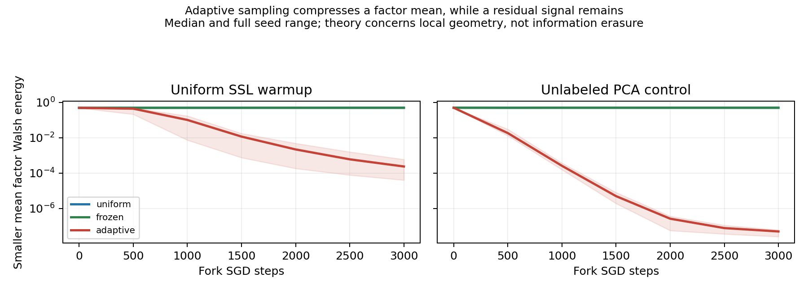

# Shared nonlinear encoder check

Status: **executed; strict replication endpoint failed; geometric compression and loss of robustness observed** (2026-10-22).

A shared 16→32 tanh→8 normalized MLP was trained without factor labels on two binary factors with fourteen continuous nuisance coordinates and a fixed invertible nonlinear renderer. All 36 fork runs completed, with six independent seeds, uniform/frozen/adaptive controls, and the separately declared unlabeled PCA initialization arm. Main training took 290 seconds on CPU with single-threaded BLAS. No training or initialization search followed the results.

Uniform SSL warmup learned nearly square geometry in this fixed training window, and initially both factors had perfect clean and noisy readouts. Adaptive easy-negative sampling subsequently compressed the weaker factor-mean energy (squared norm) by 882–7,260 times relative to frozen sampling. Mean noisy worst-factor OLS accuracy fell from 1.000 to .597. However, the original combined clean/noisy endpoint passed only 1/3 primary seeds (3/3 confirmation), below the required 2/3 in both splits. That endpoint is recorded as failed. No exact information-erasure claim is supported; a fixed OLS audit exposes residual clean information, especially in the PCA arm.

Read [manuscript_results.md](manuscript_results.md) for the full results, interpretation, limits and figure links. [protocol.md](protocol.md) records the pre-execution design; [progress.md](progress.md) separates execution and interpretation changes. The main result file is [results/runs.json](results/runs.json), the split aggregate table is [results/aggregate.md](results/aggregate.md), and the final gate is [results/summary.json](results/summary.json).

## Reproduce

Python 3.12.14 was used. The Python dependencies are pinned in [requirements.txt](requirements.txt). From the repository root:

```bash
python -m pip install -r negative-feedback/round2/encoder/requirements.txt
OPENBLAS_NUM_THREADS=1 python negative-feedback/round2/encoder/run_encoder.py
OPENBLAS_NUM_THREADS=1 python negative-feedback/round2/encoder/audit_results.py
OPENBLAS_NUM_THREADS=1 python negative-feedback/round2/encoder/analyze_results.py
```

The first command overwrites only this experiment's fixed-seed generated results. All encoder parameters are stored as small JSON arrays; no external dataset, GPU, pretrained model, or large checkpoint is needed. The loss averages a one-negative pair loss over a finite candidate batch distribution; it is not 63-negative joint InfoNCE.

## Main figures



