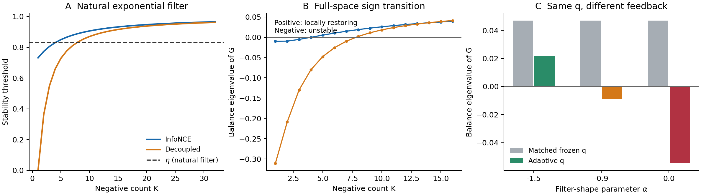
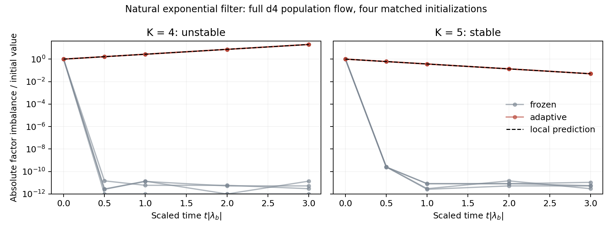
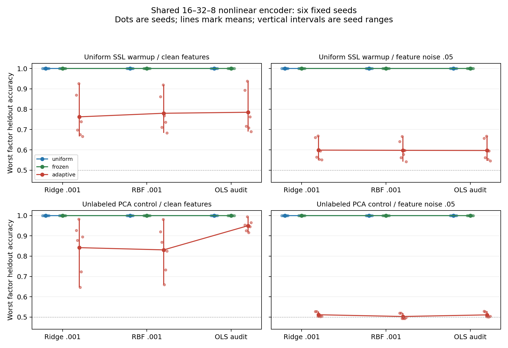

# Negative Count Controls Feedback Stability in Contrastive Learning

Research manuscript, 2026-10-22. This is a substantive theory-and-validation draft, not a submitted paper. Its claims are restricted to the models stated below. Complete derivations, independent audits, raw results, and executable protocols accompany the manuscript. Author and affiliation fields are intentionally unset.

## Abstract

Representation-dependent negative sampling changes both the current training distribution and its response to a representation update. We characterize the latter effect in a normalized four-state contrastive model with enough embedding dimension to represent every state. For any smooth positive score policy, any number K of independent negatives, and either the InfoNCE or a negative-only denominator, we derive the complete product-sphere tangent spectrum at balanced two-factor geometry. Its factor-balance eigenvalue is the product of a positive scale and the difference between a count-dependent threshold and the policy's local response elasticity. We prove that the threshold increases strictly with K and converges to one. Checkable value conditions make this scalar boundary equivalent to stability in every nonrotation direction. Natural exponential filters with a uniform probability floor possess an open region in which increasing K changes the balanced representation from unstable to attracting. One simple policy is unstable through K=4 and stable for every K≥5; removing the positive denominator delays this onset to K=8. Independent ordered-tuple calculations and directed interval arithmetic certify the predictions. Population trajectories reproduce the predicted growth and decay. A separate shared nonlinear encoder experiment finds strong factor-energy compression and reduced robustness under adaptive sampling, but fails its stricter preregistered clean-accuracy endpoint. We therefore distinguish local geometric stability and fragile factor access from exact information erasure. The contribution is an exact finite-negative stability law, not a new general feedback principle or a claim that filtering universally destroys information.

## 1. Introduction

A negative sampler is often specified by the examples it selects or the probabilities it assigns. When those probabilities depend on the current encoder, this description omits a dynamically relevant quantity: how the sampler responds when the representation changes. A small factor imbalance can alter pair similarities, alter subsequent negative probabilities, and thereby modify the forces restoring that imbalance. Even full negative support does not make this response vanish.

The general possibility is familiar. Repeated-gradient performative prediction studies learning under parameter-dependent distributions. Self-paced and robust reweighting already explain why a decreasing weight can reverse a scalar loss curvature. Encoder-dependent exponential tilting is also standard in contrastive learning. Thus an observation that adaptive sampling can destabilize a frozen objective would not, by itself, establish a new learning principle.

The quantitative question addressed here is narrower: **how do negative count and local sampling sensitivity jointly determine representation stability, and when does a factor-direction calculation actually describe the entire representation space?** A finite negative denominator changes the expected update, not just its variance. Existing finite-batch bias and negative-positive-coupling explanations make this distinction essential. However, those explanations do not by themselves predict the local attraction boundary of a changing sampler.

We answer this question exactly in a deliberately small population model. Two independent signs generate four observations. Every observation has a free unit embedding in dimension d≥3, so a tetrahedral representation is available. We study the square in which both signs have equal geometric strength. The square is a useful diagnostic equilibrium: it retains both factors, admits a factor-imbalance mode, and has additional normal directions that can invalidate an analysis confined to a rectangle. We calculate all those directions.

The principal result is a stability threshold T_K. A sampler has a local response elasticity eta, determined by the derivative of its score weight at the adjacent-state similarity. The balanced mode is restoring precisely when eta<T_K. The threshold increases strictly with K, from sigmoid(1) to one for InfoNCE. Under explicit policy-value inequalities, this same condition determines the sign of every nonrotation mode. Increasing K can therefore stabilize a representation that the same current-encoder filter destabilizes at smaller K. A natural exponential policy with a uniform floor exhibits this transition on an open parameter region; the phenomenon does not require a specially shaped score function.

Three aspects distinguish this analysis from a qualitative feedback example. First, it gives the entire tangent spectrum for arbitrary K rather than a single factor coordinate or a finite numerical sweep. Second, an inverse-moment argument proves the direction and uniqueness of the count transition. Third, a negative-only-denominator control separates the result from a pure positive-negative-coupling account: decoupling shifts the exact boundary but leaves a count-dependent transition.

We retain several falsifications. A natural exponential policy at another parameter value stabilizes factor balance while destabilizing a normal mode. The infinite-negative, zero-floor exponential limit reduces to a simple effective-temperature potential. In a nonlinear encoder, the prespecified large clean-readout loss did not replicate across both seed groups. These results constrain the claim rather than being replaced by more favorable settings.

Our numerical evidence has two roles. Exact population trajectories test the theorem's predicted dynamics, including a very slow unstable mode that a short run could mistake for stability. A separate nonlinear MLP experiment tests a limited bridge beyond independent lookup embeddings. Neither experiment establishes asymptotic semantic erasure. The theoretical contribution remains the connected finite-K spectrum, monotone threshold, and open natural-policy regime.

## 2. Related work and the remaining claim

### 2.1 Learning under changing distributions

Perdomo et al. [R1] define repeated gradient descent under a distribution induced by the current parameter. Our anchor/negative-tuple law is one such induced distribution. Their framework already supplies the distinction between optimizing against a frozen distribution and following updates under a changing one. The generic distribution-response product rule is consequently not claimed here. The relation can be demonstrated without contrastive learning: for Z∈{−1,+1}, loss theta²/2−Z theta and P(Z=1|theta)=(1+tanh(m theta))/2, the frozen curvature at zero is one for every m, whereas the adaptive field derivative is 1−m. Matching frozen weights alone is therefore a standard isolating control, not an independent general novelty claim.

Nonconvex performative optimization also exists. SPRINT [R2], inspected in its primary text, bounds a stationarity criterion based on the norm of the expected detached gradient. Both the stable and unstable squares studied here have that gradient exactly zero. Such a stationarity bound does not classify their local attraction or produce a negative-count boundary. The distinction is between the analyzed quantities, rather than a claim that prior performative theory requires convexity throughout.

Fan et al. [R3] connect self-paced weighting to implicit robust losses. At K=1 our balanced mode is locally proportional to v ell''(0)+g ell'(0), precisely the curvature of a scalar reweighted loss. This explains the one-negative sign reversal. Our additional result concerns the finite-tuple log-sum, its arbitrary-K threshold, and the other representation directions.

### 2.2 Negative sampling, number, and representation geometry

Robinson et al. [R4] explicitly use representation-dependent exponential hard-negative policies. We do not introduce this policy class. Jiang et al. [R5] analyze global representation geometry under general nondecreasing hardening functions and convex contrastive losses, with experiments on normalization and dimensional collapse. Their global-minimum results and qualitative batch-size study do not classify the current-encoder response Jacobian considered here. Our easy-filter setting is different, but that difference alone is not a contribution; the additional result is the computable local sign and its exact dependence on K.

Awasthi et al. [R6] show, under their fixed-marginal latent-class assumptions, that increasing negatives need not harm the optimal representation and characterize simplex optima. Parulekar et al. [R7] establish cluster-preserving global optima in a controlled binary representation class. Our local adaptive result neither contradicts these global fixed-sampler guarantees nor follows directly from them. Xue et al. [R8] already demonstrate feature suppression, including a minimum-norm result allowing arbitrarily large embedding dimension. Sufficient dimension is therefore a control against a hard capacity obstruction, not a claim that suppression was previously unexplained.

Wu et al. [R9] study optimal negative count with a semi-quantitative informativeness model. Chen et al. [R10] show that a finite minibatch can yield a biased gradient relative to an infinite-negative objective. Accordingly, changing K in our study changes the exact expected field; we do not interpret its effect as variance reduction at a fixed objective. Yeh et al. [R11] identify negative-positive coupling and remove the positive denominator in DCL. Section6 directly applies that modification. Its survival test is more informative than dismissing coupling verbally.

Zhang and Stratos [R14] also analyze conditional-sampler gradient bias and model-based hard negatives in supervised noise contrastive estimation. Sampling bias is therefore not newly discovered here; the additional calculation is the exact local representation-mode boundary under the stated tuple policy.

### 2.3 Recent filtering methods and interpretation

GloFND [R12] learns per-anchor quantile thresholds, starts with a pretrained encoder, ignores threshold hypergradients, and maintains additional estimation state. It motivates examining a score-based exclusion feedback, but our ideal instantaneous bottom-half rule in Section8 is not that algorithm. SnaPhArd [R13] analyzes fixed positive and negative keys for a variable query; its stated query-to-positive collapse is not factor-information erasure. Its negative-count gradient bound does not provide the closed-loop factor threshold here.

The source-by-source record specifies original sections, assumptions, theorem statements, metadata discrepancies, and inaccessible texts in [the literature audit](prior-art/literature_audit.md). The strongest defensible novelty statement is that the closest inspected results do not supply this exact full-spectrum/count law. We do not claim an exhaustive proof that no unpublished or inaccessible work overlaps.

## 3. Model, learner information, and observables

Let X=(a,b) be uniform on {−1,+1}². The four observations are indexed by i. A representation is F=(f_i) with f_i in the unit sphere S^(d−1), d≥3. Each f_i is independently trainable. Identity positives have score one. Negative states Y_1,...,Y_K are sampled independently with replacement, conditional on the anchor and current F. In particular another occurrence of the anchor's state is allowed; sampling conventions are unchanged across controls.

Let omega:[−1,1]→(0,infinity) be C² and 0<epsilon<1. The policy is

$$
q_F(j\mid i)=\frac{\epsilon}{4}+(1-\epsilon)
\frac{\omega(f_i^\top f_j)}{\sum_l\omega(f_i^\top f_l)}.
$$

Every state has probability at least epsilon/4. The loss with offset beta≥0 is

$$
\ell_{i,\beta}(F;Y)=\log\left(\beta+\sum_{r=1}^K
\exp(f_i^\top f_{Y_r}-1)\right).
$$

Beta=1 gives InfoNCE. Beta=0 deletes the identity-positive denominator term, giving the corresponding decoupled negative-only loss. Both embedding branches receive gradients. Sampling probabilities are detached within an update. Define G(F) to be the expected loss gradient, projected onto the product-sphere tangent space, with the tuple law held fixed during each gradient evaluation. The population flow is dot F=−G(F). The derivative DG includes how the next tuple law changes with F; this is not a sampler gradient inserted inside an update. Generally G is not the gradient of the composed expected loss through q.

The matched-frozen control uses q*=q(F*) at every later F. It defines an ordinary frozen objective and differs from the adaptive field only through the evolution of its law. The reference representation is

$$
f_i^*=\frac{1}{\sqrt2}(a_i,b_i,0,\ldots,0).
$$

It has scores one for the same state, zero for either adjacent state, and minus one for the opposite state. It is stationary under both policies by symmetry. Global orthogonal rotations describe the same geometry. All stability statements below remove those rotation modes.

For semantic interpretation define m_a=E[a f(X)] and m_b=E[b f(X)]. The square has ||m_a||²=||m_b||²=1/2. A factor-balance perturbation changes their difference. These energies and the representation's local stability are observables of geometry. Neither is mutual information. Nonzero arbitrarily small factor separation can preserve noiseless distinguishability; downstream noisy access is reported separately.

## 4. Exact spectrum and the count law

### 4.1 Notation

Write A=e^(−1), B=A², c=1−epsilon, and

$$
Z=\omega(1)+2\omega(0)+\omega(-1),\qquad
(t_0,t_1,t_2)=Z^{-1}(\omega(1),\omega(0),\omega(-1)).
$$

The square probabilities and local response are

$$
u=\epsilon/4+ct_0,\quad v=\epsilon/4+ct_1,\quad
w=\epsilon/4+ct_2,\quad g=c\omega'(0)/Z,\quad \eta=-g/v.
$$

Here v is the probability of each adjacent state and u+2v+w=1. Eta measures the local decrease in negative probability relative to its current adjacent probability, including the uniform floor. This is the balance-path response: its sampling normalizer has zero first derivative. It is not a general partial derivative of q with respect to one score; the other in-plane modes require the normalizer term S below.

Let (U,N,W) be multinomial counts with parameters (K;u,2v,w). Define

$$
D=\beta+U+AN+BW,\quad M=\mathbb E[N/D],\quad
C=\mathbb E[W/D],\quad R=\frac{\mathbb E[N/D^2]}{M},
$$

and S=Ut_0/u+Nt_1/v+Wt_2/w. M is strictly positive. All expectations are finite exact sums.

### 4.2 Theorem 1: the complete tangent spectrum

The eigenvalues of DG(F*) are as follows. The actual flow has their negatives.

| Direction and multiplicity | Matched frozen | Adaptive |
|---|---|---|
| Factor balance, 1 | lambda_b=AM−A²E[N/D²] | lambda_b+AgM/v |
| Other in-plane characters, 2 | lambda_p=AM/2−(A²/4)E[(N²+N)/D²]+BC | lambda_p+Ag{E[(N²+N)/D]/(4v)−E[NS/D]/2} |
| Normal constant character, d−2 | AM/2+BC | same |
| Normal product character, d−2 | −AM/2+BC | same |
| Rotations, 2d−3 | 0 | 0 |

The multiplicities sum to 4(d−1), the entire tangent dimension.

**Proof.** The square symmetries diagonalize the in-plane block into binary characters and separate each normal-coordinate block. The two nonbalance in-plane modes are degenerate under interchange of a,b. A great-circle perturbation for each character has squared tangent norm four.

For balance use f_i(theta)=(cos(theta)a_i,sin(theta)b_i,0,...), theta=pi/4 at the square. Adjacent score derivatives are −2,+2; self and opposite score derivatives vanish. If N_1,N_2 are adjacent counts and Delta=N_2−N_1, then conditional symmetry gives E[Delta²|U,N,W]=N. The loss derivative is 2A Delta/D and its frozen second derivative is 4AN/D−4A²Delta²/D². The sampling normalizer has zero first derivative in this direction. The tuple log-probability derivative is 2g Delta/v. Differentiating the expected detached derivative therefore adds 4Ag Delta²/(vD). Conditional averaging and division by the metric four yield the first row.

For either other in-plane character, one adjacent score derivative is ±2, the other is zero, and the opposite score second derivative is four. Conditional moments are E[N_2|U,N,W]=N/2 and E[N_2²|U,N,W]=(N²+N)/4. The frozen directional second derivative is 4AN_2/D−4A²N_2²/D²+4BW/D. The tuple log-probability response is g(−2N_2/v+2S) for the representative with negative adjacent derivative. Multiply by its loss derivative −2AN_2/D, average, and divide by four. This gives the second row, including the row-normalizer contribution S.

In a normal direction with character chi, write f_i(t)=cos(t)f_i*+sin(t)chi_i e_normal. Every first score derivative vanishes, so there is no sampler-response term. Its second derivative is 2(chi_i chi_j−s_ij). Constant and product characters produce 2AN/D+4BW/D and −2AN/D+4BW/D, respectively. Division by four yields the normal rows. Normal a,b characters and the in-plane constant character are rotations. All modes are now accounted for. QED.

This proof matters for scope. A positive balance curvature alone does not imply full stability; the normal product row can have the opposite sign.

### 4.3 Theorem 2: a strictly monotone count threshold

Define

$$
T_{K,\beta}=1-A\frac{\mathbb E[N/D^2]}{\mathbb E[N/D]}.
$$

Then the adaptive balance eigenvalue is exactly

$$
\boxed{\lambda_b^{\mathrm{adaptive}}=AM(T_{K,\beta}-\eta).}
$$

For every beta≥0, T_(K,beta) strictly increases with K and tends to one. Its initial value is beta/(beta+A). For each fixed K it strictly increases with beta. Consequently InfoNCE has T_(1,1)=sigmoid(1), whereas DCL has T_(1,0)=0 and T_(K,0)<T_(K,1) at every finite K.

**Proof.** The factorization follows from Theorem1. For monotonicity, select one of the K exchangeable negative draws and condition it to be adjacent. With iid Z_l taking values 1,A,B with probabilities u,2v,w, the size-bias identity gives

$$
\mathbb E[N/D^p]=2Kv\,\mathbb E[Y_{K,\beta}^{-p}],\qquad
Y_{K,\beta}=\beta+A+\sum_{l=1}^{K-1}Z_l.
$$

Thus R is an inverse-moment ratio. For any positive bounded Y, put m_j(z)=E[(Y+z)^(−j)] and r(z)=m_2(z)/m_1(z). Direct differentiation gives

$$
r'(z)=\frac{-2m_3(z)m_1(z)+m_2(z)^2}{m_1(z)^2}<0,
$$

since Cauchy–Schwarz implies m_3m_1≥m_2². Adding an independent positive random shift Z gives a positive-weighted average of the deterministic-shift ratios r(Z), each smaller than r(0). Therefore R strictly decreases when one more iid negative is added. Increasing beta is a deterministic shift and has the same effect. Finally Z_l≥B>0 implies R≤1/[beta+A+(K−1)B], so R→0 and T→1. The K1 value follows from constant Y_1=beta+A. QED.

For InfoNCE, eta<sigmoid(1) gives balance attraction for every K. Eta≥1 gives instability for every finite K. For sigmoid(1)<eta<1, increasing K crosses at most once from instability to attraction, with equality left unclassified. The large-K expansion is T_(K,beta)=1−A/(K mu)+o(1/K), where mu=u+2Av+Bw. Bounded convergence applied to Y/K establishes this expansion. These are exact population effects; they are present without any optimizer noise.

### 4.4 Theorem 3: when balance determines every mode

Suppose

$$
g\le0,\qquad t_2/t_0\ge e,\qquad Bw>Av.
$$

Then the adaptive square has positive eigenvalues in every nonrotation direction if and only if eta<T_(K,beta). If eta>T_(K,beta), it is unstable. Equality is not classified. The frozen square is strictly attracting modulo rotations except at K1,beta0, whose balance mode is zero.

**Proof.** Frozen balance is positive except for the stated DCL degeneracy. Frozen other in-plane curvature is positive by its unaggregated nonnegative second-derivative form. The normal constant row is positive. For the normal product row, write L_m=sum_(l=1)^m Z_l for the iid variables defined in Theorem2. Size-bias conditioning gives

$$
C=Kw\,\mathbb E[(\beta+B+L_{K-1})^{-1}],\qquad
M=2Kv\,\mathbb E[(\beta+A+L_{K-1})^{-1}].
$$

Since B<A and Bw>Av, BC>AM/2. Both normal modes are therefore positive for every K.

Let C_b=AM/v and C_p=A{E[(N²+N)/D]/(4v)−E[NS/D]/2} be the response coefficients multiplying g. For K≥2, a second size-bias expansion yields

$$
C_p/A=\frac{M(1-t_1)}{2v}+K(K-1)v
\{t_0(F_A-F_1)+t_2(F_A-F_B)\},
$$

where F_z=E[(beta+A+z+L_(K−2))^(−1)]. For each y=beta+A+L_(K−2),

$$
\frac{(y+A)^{-1}-(y+1)^{-1}}
{(y+B)^{-1}-(y+A)^{-1}}
=\frac1A\frac{y+B}{y+1}<\frac1A.
$$

The condition t_2/t_0≥1/A makes the bracket nonpositive. Hence C_p<C_b/2. For K1 the absent K(K−1) term gives the same bound directly. Since g≤0,

$$
\lambda_p^{A}\ge\lambda_b^{A}/2+
(\lambda_p^{F}-\lambda_b^{F}/2).
$$

The frozen residual is BC−(A²/4)E[N(N−1)/D²]. Using A(N−1)<D and BC>AM/2 makes it strictly positive. Positive adaptive balance therefore implies positivity of both remaining in-plane eigenvalues. A negative balance eigenvalue itself establishes instability. QED.

These value assumptions are sufficient, not necessary conditions on all policies. Their role is substantive: they rule out an unstable normal direction that a tied-angle calculation cannot see.

## 5. Natural exponential policies and an open stabilization regime

The count transition is not confined to a score function engineered to match three values. Let omega(s)=exp(−t s) with t>1 and define

$$
Z_t=e^{-t}+2+e^t,\qquad
\rho=\frac{1-\epsilon}{\epsilon Z_t/4+1-\epsilon}.
$$

Then eta=t rho and w/v=1+rho(e^t−1). The full-space value conditions hold whenever rho>(e−1)/(e^t−1). The interval

$$
\max\left\{\frac{e-1}{e^t-1},\frac{\operatorname{sigmoid}(1)}{t}\right\}
<\rho<\frac1t
$$

is nonempty for every t>1. Indeed e^t−1>t(e−1) for t>1, while sigmoid(1)<1. Every rho in (0,1) corresponds to a unique epsilon in (0,1), via

$$
\epsilon=\frac{4(1/\rho-1)/Z_t}{1+4(1/\rho-1)/Z_t}.
$$

Under InfoNCE, the square is frozen-stable for all K, adaptive-unstable at K1, and adaptive-stable for all sufficiently large K. All inequalities are strict and continuous, proving an open parameter region. The corresponding DCL threshold also tends to one, but is smaller at every finite K, so its onset cannot be earlier.

A simple analytic instance is t=log4,epsilon=.3. It has exact rational square probabilities

$$
(u,v,v,w)=(103,187,187,523)/1000,\qquad
\eta=(112/187)\log4\approx .830293948906.
$$

Here t_2/t_0=16>e and w/v=523/187>e. Exact finite sums give the following cutoffs. Independent outward-rounded interval computations certify the signs, including e and log4 tail bounds; these are not merely matching double-precision calculations.

| Policy | Denominator | Last unstable K | T_K−eta there | First stable K | T_K−eta there |
|---|---|---:|---:|---:|---:|
| exp(−log4 s),epsilon.3 | InfoNCE | 4 | −.00037020814 | 5 | +.01917562196 |
| Same natural policy | DCL | 7 | −.02114304669 | 8 | +.00422431518 |
| Matched-value family,alpha−.9 | InfoNCE | 8 | −.00117441276 | 9 | +.00810995775 |
| Same matched-value policy | DCL | 13 | −.00008291871 | 14 | +.00927784626 |

Combining a certified adjacent integer bracket with strict monotonicity and Theorem3 establishes every subsequent K, not just counts up to the numerical sweep. The natural instance was chosen from analytic value/slope inequalities after the initial protocol and the earlier natural-policy failure, then proved to lie in an open stabilization regime and executed as a theorem illustration. It is not a held-out parameter discovery or an empirical success-rate estimate.

**Figure1.** Exact count expectations. A: natural exponential policy thresholds for InfoNCE and DCL against its fixed response eta. B: balance eigenvalue; under the verified full-space inequalities its sign determines complete transverse stability. C: matched square laws have the same frozen geometry but different response slopes at K1. The negative count changes the tuple loss and expected field, not the single-draw law at the square.

## 6. Controls against simpler interpretations

### 6.1 Matching static weights does not match the response

For omega_alpha(s)=exp[−2s+alpha s(s²−1)],alpha in [−2,1], every policy is nonincreasing on [−1,1]. All agree at scores −1,0,1, hence induce exactly the same square law and exactly the same frozen objective for every F. Their derivative at zero is −2−alpha. For InfoNCE (beta=1), with epsilon=.1,alpha−1.5 gives eta=.39539244 and stability for every K; alpha0 gives eta=1.58156974 and instability for every finite K. Alpha−.9 crosses at K9 for InfoNCE.

This construction isolates what cannot be inferred from q* or a static loss table. As discussed in Section2, matching values while varying derivatives is not itself a new general theorem. It is a control supporting the finite-K response interpretation.

### 6.2 Positive-negative coupling changes, but does not exhaust, the boundary

For a fixed tuple with negative denominator D_−, the InfoNCE gradient equals the DCL gradient multiplied by D_−/(1+D_−). This is the established coupling identified in DCL [R11]. The beta monotonicity theorem quantifies its contribution to our boundary: deleting the positive term lowers T at every finite K. It delays the natural policy's onset from K5 to K8. Yet the DCL threshold itself rises strictly from zero to one, and the transition remains. Thus a pure NPC explanation is insufficient, while finite-negative log-sum curvature remains part of the explanation. We do not claim DCL performs worse in practical representation learning.

### 6.3 Infinite-negative effective temperature is an acknowledged reduction

For epsilon0 and omega(s)=exp(−t s), the K-infinite expected gradient weights are proportional to q_j exp(s_j), hence equal softmax((1−t)s_j). For t≠1 the field is the projected gradient of the row log-partition divided by 1−t. At t1 the limiting weights are uniform. An independent 60-case calculation verifies this identity to1.11e−16. This elementary effective-temperature limit explains the limiting critical slope one; it is excluded from the novelty claim. The finite-K threshold and the nonzero-floor open regime require further analysis. The floor is mathematically active: with epsilon0 and t>1,eta=t>1 and balance is unstable at every finite K.

### 6.4 A normal-mode counterexample prevents overinterpretation

With the natural policy omega(s)=exp(−s),epsilon=.1, K8 has positive balance curvature .00436686 but negative normal-product curvature −.00145613. At K128 the respective values are .05423005 and −.01724015. In the limit w/v≈2.506<e, so the normal instability is exact. This policy does not exhibit full-space rescue. It was checked and retained before the later analytic log4 example. It refutes a claim that scalar balance stabilization always restores the representation, and does not refute the proved open regime.

### 6.5 Holding the target sampling objective fixed by importance correction

If the update is multiplied by the detached tuple likelihood ratio product_r[p(Y_r)/q_F(Y_r)], exact change of measure restores the uniform-sampler expected gradient at every F when p is uniform. This is an elementary identity, not a new method. An earlier90-setting tied-angle scalar-gradient enumeration agreed with the uniform reference to1.39e−15; it was not90 complete-vector-field checks. The saved [code](../code/importance_control.py) and [raw result](../results/importance_control.json) preserve the control. Thus our uncorrected phenomenon concerns a changing expected update field, rather than optimization failure at an unchanged uniform objective. The identity does not promise low finite-sample variance or cover clipping/self-normalization of weights.

## 7. Executed validation

### 7.1 Algebra and independent implementation

The author calculation uses three-category multinomial moments for spectrum formulas and a separate four-category population field for finite differences. It evaluated 1,024 policy/count/denominator settings and52 d4 tangent settings, checking both frozen and adaptive spectra in each setting. The largest eigenvalue discrepancy was9.04e−11. Rotated coordinates, stationary residuals, probability normalization, and count aggregation were checked.

An independent critic implemented the field through ordered iid tuples, without importing the author's aggregation code, and used a different tangent basis. There were78 full twelve-dimensional spectrum comparisons, including natural-policy and DCL checks; the largest discrepancy was5.73e−11. The critic independently rederived the count-size-bias identities, the strict inverse-moment monotonicity, the response-coefficient inequality, and the open-regime argument. Directed interval programs certify all four integer brackets in Table1. Counts of checks are consistency checks on one mathematical model, not independent application datasets or estimates of general success probabilities.

### 7.2 Predicted dynamics around the natural-policy cutoff

We integrated the exact population field at K4 and K5 under frozen and adaptive policies, from four matched initializations including arbitrary d4 perturbations. A protocol was written before these trajectories, after the theorem selected the counts. The initial factor angle was pi/4+1e−5, with iid ambient perturbation of scale1e−6, followed by normalization. Hence the path was not artificially constrained to the tied angle.

The measured rotation-invariant imbalance was B(F)=||E[a f]||²−||E[b f]||². Radau integration used rtol1e−8,atol1e−12 to time3/abs(lambda_b^adaptive), fixed from the predicted local rate. K4 has lambda_b=−9.1488991e−5, an e-fold time of about10,930. K5 has lambda_b=.005228608. The time normalization prevents a short observation window from disguising the weak K4 instability.

| Policy | K | Final abs(B/B_initial), four runs | Local prediction |
|---|---:|---:|---:|
| Adaptive | 4 | 20.08518–20.08533 | exp(3)=20.08554 |
| Adaptive | 5 | .049787075–.049787081 | exp(−3)=.049787068 |
| Frozen | 4 and5 | ≤1.39e−11 | contraction; final values reach numerical floor |

All16 prospectively fixed trajectory criteria passed. The maximum unit-norm error was3.75e−13. The final perturbations remain local. These curves validate growth/decay of a geometric mode; they do not establish a global basin or eventual factor deletion.

**Figure2.** Exact population flow from four generic initializations. Dashed lines show the local adaptive prediction, not a fitted curve. Frozen endpoints near zero are displayed with a1e−12 plotting floor and are not used to infer a rate. The horizontal axis is scaled separately by each K's predicted rate; equal scaled time is not equal computation or physical flow time.

### 7.3 A shared nonlinear encoder: support and a failed stronger endpoint

A separate preregistered synthetic experiment uses two uniform binary factors plus14 continuous nuisance coordinates, a fixed orthogonal renderer and an invertible smooth warp. Positive views share the factors and independently redraw nuisance. The encoder is a shared16→32 tanh→8 MLP with exact output normalization. Factor labels are used only for evaluation. Each seed has1,000 uniform SSL warmup steps, then3,000 steps for uniform, frozen-snapshot and adaptive forks using identical observation streams. A separately declared unlabeled PCA initialization is a mechanistic control.

The batch size is64,learning rate.05, with no momentum or weight decay. The filtering law uses epsilon.1,kappa−2 and a positive floor on every off-diagonal candidate. The batch loss exactly averages **one-negative logistic losses** over q; it is not the joint63-negative InfoNCE loss. Accordingly this study does not empirically verify the multi-negative K5 boundary. It tests a different, limited question: whether compression under changing q requires independently trainable lookup embeddings.

There are six fixed seeds, divided before training into three primary and three confirmation seeds, giving36 fork runs across two initializations and three policies. The primary clean/noisy replication endpoint required at least.15 clean linear accuracy loss and at least.20 noisy loss in two of three seeds in each split. Warmup passed1/3 primary and3/3 confirmation; PCA passed0/3 and2/3. **The stronger endpoint failed.** Neither confirmation success nor a post hoc probe was substituted for it.

The uniform-warmup representations were nearly square: interaction energy fractions were3.04e−5–3.09e−4. After adaptive training, weaker factor coefficient energy was6.84e−5–5.65e−4, compared with.495–.498 under frozen sampling. The paired energy ratio was882–7,260; these are squared norms, not a corresponding ratio of information or coefficient norms.

All uniform and frozen runs attained1.000 for every reported factor readout. Adaptive results below are worst-factor accuracy, mean [minimum,maximum] over six seeds, with brackets denoting seed ranges rather than confidence intervals. The feature-noise channel adds independent Gaussian noise of standard deviation.05 to both probe-training and test features.

| Initialization | Clean ridge | Clean RBF | Clean OLS audit | Noisy OLS audit |
|---|---:|---:|---:|---:|
| Uniform SSL warmup | .762 [.667,.926] | .780 [.684,.920] | .785 [.689,.938] | .597 [.545,.667] |
| Unlabeled PCA control | .842 [.646,.982] | .831 [.660,.980] | .950 [.916,.995] | .511 [.501,.529] |

OLS was a fixed post-observation diagnostic motivated by a concrete alternative explanation: ridge regularization might hide a tiny but available factor direction. It used centered least squares with rcond1e−10, without a tuning sweep. PCA clean access largely recovers with OLS, preventing an information-erasure interpretation. Under the fixed noise channel, all readouts agree closely about reduced access. The result supports geometric compression and fragility, while leaving exact noiseless information unresolved.

Manual gradients passed a pretraining50-coordinate finite-difference gate with maximum absolute discrepancy6.00e−11. A later relative-error audit gave4.03e−8. Snapshot-frozen and adaptive loss and gradients matched exactly at all12 initial snapshots; final norm error was3.33e−16. The raw inverse-renderer oracle and all initial heavy probes recovered both factors at1.000. A read-only independent code audit confirmed the detached gradient, shared branches, immutable snapshot, common streams and evaluation-only use of labels. The complete protocol, model arrays, metrics and split-level results are linked in [the encoder report](encoder/manuscript_results.md).

**Figure3.** Shared nonlinear encoder readouts; dots are seeds and intervals are seed ranges. The difference between clean OLS recovery and noisy access is central to the interpretation. These are four semantic-state synthetic data with continuous nuisance, one renderer, one policy setting and a finite training window, not evidence about all pretrained or natural-image encoders.

## 8. A separate nonsmooth rank-policy result

To avoid pretending that smooth sensitivity directly describes top-k selection, we analyzed an ideal bottom-half rank rule separately. Exclude the anchor from three equally weighted candidate states; retain the lowest-score original probability mass1/2, split exact boundary ties uniformly, renormalize, and mix an epsilon uniform-over-three floor.

At the square, opposite probability is w=(2−epsilon)/3 and each adjacent probability is v=(1+epsilon)/6. At epsilon.1, the frozen square is strictly stable modulo rotations, with slowest flow eigenvalue−.0261893. Any nonzero factor-angle imbalance breaks the adjacent tie. The lower adjacent probability becomes1/3 and the higher becomes epsilon/3. Taking the one-sided limit of the loss derivative and dividing by tangent metric four yields angle speeds

$$
\lim_{\delta\to0^\pm}\dot\theta(\pi/4+\delta)
=\pm\frac{(1-\epsilon)\operatorname{sigmoid}(-1)}6
=\pm .0403412132\quad(\epsilon=.1).
$$

The tied plane is invariant, so the exact-equality equilibrium is Lyapunov unstable. This is not a smooth-Jacobian result. An independent scalar audit confirms the algebra, while six generic d4 numerical perturbations show finite-scale adaptive expansion and frozen contraction.

A consequential implementation difference emerged in review. A positive tie tolerance creates an open tied band in which the sampler is frozen-like and restoring. With tolerance1e−12,delta1e−13 gives velocity approximately−7.2e−15, whereas the ideal rank branch gives+.0403412. Thus the floating-point implementation is not infinitesimally unstable in the same sense. Our trajectories start well outside this band. The report and code preserve both branches. This limited result illustrates a boundary mechanism and must not be presented as a failure of GloFND's threshold/EMA algorithm.

## 9. What has and has not been established

The core mathematical claim is complete within the stated population model. It does not depend on a future proof of the threshold, unexecuted GPU training, or an assumed encoder failure. The spectrum, monotonicity, full-space conditions, natural-policy open region and denominator control have proofs; the integer examples have independent interval certificates; predicted local dynamics have been run.

The result changes a specific inference one might make from static sampling or finite-batch intuition. A current negative law, positive support and sufficient nominal dimension do not determine adaptive restoring behavior. Negative count can change the sign of that behavior in a noiseless expected field, with a computable threshold. Conversely a favorable factor-coordinate sign does not guarantee stability without inspecting other modes. These are quantitative constraints on a contrastive learning dynamics, rather than an algorithmic improvement claim.

Substantial limits remain. The theory uses uniform four-state data, identity positives, temperature one, iid negatives with replacement and independently trainable unit embeddings. Square geometry is not a global optimum claim or a guarantee about random initialization. Normalization retains a real geometric resource constraint. A parameterized encoder changes the tangent metric; nuisance and minibatch composition alter the expected field. The theorem neither proves a stable omitted-factor equilibrium nor calculates MI loss. Equality eta=T is not classified. The rank-policy result depends on an ideal tie convention and is auxiliary.

The nonlinear experiment weakens the independent-lookup objection, but retains four semantic combinations and does not test the exact multi-negative cutoff. Its failed primary endpoint is a real limit. We therefore do not position this as a universal theory of semantic blindness or practical false-negative detection. Expanding such a claim would require new central evidence, not merely supplementary benchmarking.

For the present narrow theoretical paper, remaining work is reinforcement: test the finite-K phase prediction under shared encoders or more semantic states; assess stability under small departures from the symmetric population; and simplify presentation of the full-spectrum sufficient conditions. A broad pretrained-information-loss paper is not complete and is not the recommendation here. No natural-image improvement, missing theorem, or expected result is inserted into this draft.

## 10. Reproducibility and research record

All code uses Python with NumPy/SciPy/Matplotlib on CPU. The manuscript's [reproduction guide](reproduction.md) lists commands, environment, seeds, raw result files, figure provenance, and independent audit programs. Protocols distinguish original execution criteria from post-proof controls and post-observation diagnostics. Early hypotheses, failed endpoints, counterexamples and implementation-only corrections remain in progress logs. Compact MLP parameters are saved; external datasets and large checkpoints are unnecessary.

The mathematical file [theory/theorem.md](theory/theorem.md) contains the expanded six-theorem derivation. The independent [mathematical audit](review/review.md) includes the certificate correction history and the numerical tie objection. The [prior-art audit](prior-art/literature_audit.md) specifies what was actually read. These records are evidence-bearing parts of the draft rather than promises to perform the work later.

## References

- **[R1; closest framework]** Perdomo, Zrnic, Mendler-Dünner, Hardt. *Performative Prediction*. ICML2020. [Primary PDF](https://proceedings.mlr.press/v119/perdomo20a/perdomo20a.pdf). Repeated-gradient formulation and induced-distribution sensitivity.
- **[R2; recent framework]** Xie, Zhu, Liu, Khalili, Zhang. *SPRINT: Stochastic Performative Prediction With Variance Reduction*. arXiv2025; TMLR2026 record checked. [Primary full text](https://arxiv.org/html/2509.17304v2). Nonconvex stationarity guarantees; distinguished from local attraction.
- **[R3; closest K1 explanation]** Fan, He, Liang, Hu. *Self-Paced Learning: an Implicit Regularization Perspective*. arXiv2016/AAAI2017. [Primary PDF](https://arxiv.org/pdf/1606.00128). Scalar robust-loss interpretation.
- **[R4]** Robinson, Chuang, Sra, Jegelka. *Contrastive Learning with Hard Negative Samples*. ICLR2021. [Primary PDF](https://arxiv.org/pdf/2010.04592). Encoder-dependent exponential sampling, global limiting analysis.
- **[R5; closest geometry study]** Jiang, Nguyen, Aeron, Ishwar. *Hard-Negative Sampling for Contrastive Learning: Optimal Representation Geometry and Neural- vs Dimensional-Collapse*. TMLR2025. [Primary full text](https://arxiv.org/html/2311.05139v3), [official journal index](https://jmlr.org/tmlr/papers/). Global geometry and normalization. The experimental HTML body date conflicts with arXiv/journal metadata; the audit records this and uses the official publication year.
- **[R6]** Awasthi, Dikkala, Kamath. *Do More Negative Samples Necessarily Hurt in Contrastive Learning?* ICML2022. [Primary PDF](https://arxiv.org/pdf/2205.01789v2). Fixed-sampler global optima and K.
- **[R7]** Parulekar et al. *InfoNCE Loss Provably Learns Cluster-Preserving Representations*. COLT2023. [Primary PDF](https://proceedings.mlr.press/v195/parulekar23a/parulekar23a.pdf). Restricted-class cluster-preserving optimum theorem.
- **[R8]** Xue et al. *Which Features are Learnt by Contrastive Learning? On the Role of Simplicity Bias in Class Collapse and Feature Suppression*. ICML2023. [Primary PDF](https://proceedings.mlr.press/v202/xue23d/xue23d.pdf). Existing suppression mechanisms and limits of capacity-based explanations.
- **[R9; closest count question]** Wu, Wu, Huang. *Rethinking InfoNCE: How Many Negative Samples Do You Need?* IJCAI2022. [Primary PDF](https://www.ijcai.org/proceedings/2022/0348.pdf). Informativeness-based count model; different analyzed quantity.
- **[R10; closest finite-K explanation]** Chen et al. *Why do We Need Large Batchsizes in Contrastive Learning? A Gradient-Bias Perspective*. NeurIPS2022. [Primary PDF](https://papers.nips.cc/paper_files/paper/2022/file/db174d373133dcc6bf83bc98e4b681f8-Paper-Conference.pdf). Finite-batch expected-gradient bias.
- **[R11; directly tested alternative]** Yeh et al. *Decoupled Contrastive Learning*. ECCV2022. [Primary PDF](https://www.ecva.net/papers/eccv_2022/papers_ECCV/papers/136860653.pdf). NPC derivation and negative-only denominator control.
- **[R12]** Balmaseda, Wang, Lin, Yang. *Discovering Global False Negatives On the Fly for Self-supervised Contrastive Learning*. ICML2025. [Official record](https://proceedings.mlr.press/v267/balmaseda25a.html), [primary full text](https://arxiv.org/html/2502.20612v2). Practical learned quantile filtering, not the ideal rank theorem's algorithm.
- **[R13]** Meng, Yang, Li, Guo. *SnaPhArd Contrast Learning*. ICLR2026. [Official PDF](https://proceedings.iclr.cc/paper_files/paper/2026/file/42a24a7a3e7cf7dd127a76daf487cffd-Paper-Conference.pdf). Fixed-key query optimality and negative-count gradient result.

- **[R14; conditional sampling bias]** Zhang, Stratos. *Understanding Hard Negatives in Noise Contrastive Estimation*. NAACL2021. [Primary PDF](https://aclanthology.org/2021.naacl-main.86.pdf). Conditional-candidate gradient-bias theorems and model-based sampling.
