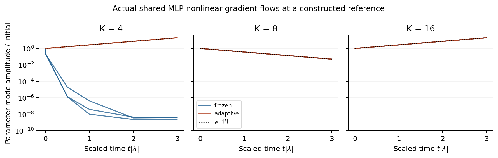
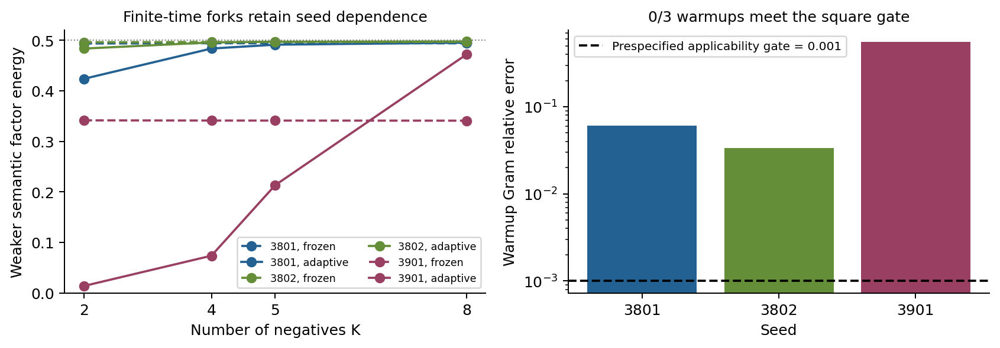

# Executed results and strongest limitations

2026-10-22. These are population calculations and actual CPU runs, not a proposed future experiment. Original prior results are not counted as new executions. Exploratory and confirmation choices are separated in [protocol.md](protocol.md).

## 1. What changed relative to the preceding result

The preceding shared MLP used an average of one-negative losses. That objective has no joint-K denominator, so it did not test the all-K stability law. Here `oracle.py` directly evaluates expected multi-negative InfoNCE for arbitrary finite embeddings/positive channels, including the gradient of both encoder branches. The current sampling probabilities are used as detached coefficients inside an update. Comparing the resulting vector field across representations includes sampler response; differentiating the sampler inside the loss is a different algorithm and is not done.

A stronger issue emerged after removing this mismatch: class-mean balance stability need not be full stability when positives only weakly connect nuisance views. We derived the complete new view spectrum and a finite count-window law. This is a documented change of central question, not an unreported search for a favorable seed.

## 2. Oracle validity

| Check | Executed conditions | Maximum discrepancy |
|---|---|---:|
| Independent multinomial enumeration | N4,K1/2/4/5/8/16,64/96/128 quadrature nodes | value2.49e-14,gradient5.97e-15 |
| Fixed-policy loss finite differences | 20 selected embedding coordinates | 3.01e-10 |
| Quadrature convergence | N16 random embeddings,96 versus128 nodes | approximately1e-14 value,1e-15 gradient |

[Raw oracle output](results/oracle_validation.json), [implementation](oracle.py), [independent validation](validate_oracle.py). For arbitrary fixed positive channel P, the oracle computes a one-dimensional Laplace integral over iid negative draws. This avoids negative-sampling variance; it does not remove finite-population scope. Numerical quadrature is numeric evidence, not symbolic exact arithmetic.

The manual MLP backward and output Jacobian share implementation. To avoid a shared chain-rule bug passing a self-comparison, an additional fixed random-parameter scalar-loss test checks20coordinates across all4parameter blocks: maximum absolute error4.50e-10,applicable relative error3.65e-7,all fixed gates pass. [Raw independent scalar-loss diagnostic](results/parameter_gradient_check.json),[code](check_parameter_gradient.py). This tests the implementation, not a scientific hypothesis.

## 3. Full tangent theorem and numeric checks

For four semantic classes, m views per class, normalized d-dimensional embeddings, let μ be a nonconstant eigenvalue of a symmetric within-class positive channel. At the class-collapsed square, the old class-mean spectrum is divided by m and all added eigenvalues are

\[
\lambda_{\mathrm{view,normal}}(\mu)=\frac{\lambda_+-B_{\mathrm{tot}}\mu/2}{m},\quad
\lambda_{\mathrm{view,plane}}(\mu)=\lambda_{\mathrm{view,normal}}(\mu)+\frac{\lambda_b}{2m}.
\]

Definitions and direct proof are in [view_theorem.md](view_theorem.md); this statement includes all within-class view directions rather than one hand-picked perturbation. Symmetry ensures the zero-class-mean and class-mean blocks decouple. Stability means positive real eigenvalues of the learning gradient field, equivalently attraction under negative-gradient dynamics, modulo exact rotations.

| Test | Conditions | Maximum error |
|---|---|---:|
| Class/view decomposition | m2/4,d8,K1/2/4/5/8/16,frozen/adaptive:24 settings | class spectrum3.95e-11,cross block1.31e-11 |
| Complete lazy positive graph | K3/5/16/64,rho0/.05/.1/.2/1:20 settings | entire spectrum2.24e-10 |
| Noncomplete positive graph | lazy4cycle/reflecting4path,scale.05/.2,K5/8/16:12 settings | entire spectrum3.16e-11 |

Raw outputs: [view_spectrum.csv](results/view_spectrum.csv), [mixing_fd.csv](results/mixing_fd.csv), [graph_fd.csv](results/graph_fd.csv). Symmetric finite-difference matrices were checked before treating their eigenvalues as a full spectrum.

## 4. All-K bounded stability window

Let gamma be the algebraic positive-graph gap, Btot the expected total negative softmax mass, and xi_K=(b0−b2)/Btot. The tagged-negative Stieltjes-transform proof establishes **strictly increasing xi_K for all K**, not merely the evaluated grid. The existing all-K balance theorem gives a lower count constraint. Their intersection has exactly one stable integer interval, possibly empty, finite or unbounded, under its stated policy conditions.

The fixed pre-curve rho grid included0,.025,.05,.075,.1,.15,.3,1. It was not limited to a bounded-window success. In K1–128, rho0 has no stable K, .025 has5–6,.05 has5–11,.075 has5–24,.1 and above have5–128. **The rho.1 observed range is not an all-K stable claim:** xi_infinity=.10347795217711 exceeds.1, implying eventual failure.

For rho=.05, 70-digit outward arithmetic certifies xi11=.04853516089345...<.05 and xi12=.05201103415789...>.05. Monotonicity plus the prior independently certified lower cutoff establishes **exactly K5–11**. [New interval certificate](results/mixing_interval_certificate.json), [finite-sum implementation](certify_mixing.py). The interval class is imported from the prior reviewed implementation; the new arithmetic and proof are available for independent replication.

The upper boundary is **shared by frozen and adaptive**. Its mechanism is a static objective's negative repulsion versus weak positive consistency, with a K-dependent tagged-negative weighting. The lower boundary is the adaptive feedback balance instability. It would be incorrect to describe both as one feedback mode or to conclude that K12 destroys a semantic factor.

### Removing the positive self-loop artifact

A final analytically selected corollary uses20views per class and a simple cycle positive channel with zero diagonal and neighbor probabilities1/2. Its exact algebraic gap1−sqrt(10+2sqrt5)/4=.04894348 lies between xi11 and xi12; the [independent radical certificate](../journal/zero_self_cycle_certificate.json) provides rational outward bounds. Thus the same all-K full adaptive window5–11 exists **with no identical-observation positives**. This removes the95%self-target artifact; weak graph connectivity remains an explicit condition.

An independent N80,d8 joint-oracle normal-direction derivative test at K11/12,frozen/adaptive passes all 4 fixed checks: maximum vector residual8.40e-12,relative Rayleigh discrepancy1.03e-6. Predicted normal curvature changes from+7.815652247e-6 at K11to−5.992421405e-5 at K12. Full560D analytic inertia is0negative at K11 and 48negative at K12 for both policies. That full spectrum is algebraic, not a full numericJacobian check. [Raw data](results/cycle_no_self.json),[code](cycle_no_self.py),[theorem corollary](view_theorem.md).

## 5. Actual shared neural encoder

Architecture16→64 tanh→8 normalized;1608 trainable parameters. N16 inputs contain two latent signs and14 nuisance values, followed by a fixed orthogonal renderer. Positive correspondence is given. In the mechanism arm, two known population renderer directions construct the square, while random additional hidden units make every view tangent accessible. The full output Jacobian rank is112, the complete N16 product-sphere tangent dimension. **This is an oracle reference construction; it is not an ordinary label-free initialization.**

At uniform positives, seeds3501/3502(primary)/3701(confirmation),K4/5:

- Stationary parameter gradient residual≤3.34e-16.
- Direct parameter-gradient finite differences versus pullback maximum relative matrix error4.22e-10.
- K4 adaptive one negative mode; K5 none; exact rotational zero modes retained.
-14 nonlinear flow/half-step runs satisfy the fixed sign criteria. The pullback/inertia relation is standard mathematics, not a new contribution.

[Raw parameter spectra](results/parameter_spectrum.csv), [flow summary](results/parameter_summary.json), [actual final embeddings](results/parameter_final_embeddings.json), [code](shared_parameter.py).

For the new window, fresh seeds4101/4102(primary)/4301(confirmation),rho=.05,K4/8/16:

| K | Frozen negative parameter modes | Adaptive negative parameter modes | Observed selected-mode ratio after3 e-fold times |
|---:|---:|---:|---|
|4|0|1|frozen<3.84e-9;adaptive20.1419–20.1437|
|8|0|0|both approximately.0499363–.0499366|
|16|72|72|both20.14594–20.14598|

These are18 primary+confirmation trajectories and3 half-step diagnostics. **21/21** prespecified acceptance checks pass; actual parameter-direction derivative error≤1.624e-9, half-step discrepancy≤.001505. Every gradient is recomputed at the changing actual parameters. The linearly implicit solver uses a fixed reference Jacobian solely to handle stiffness, so its linear discrete prediction is20.14596 rather than exp(3)=20.08554.

To attack numerical circularity, a separate standard **unpreconditioned DOP853** run reused seed4101/K16 and the same initial perturbation. Frozen/adaptive give ratios20.08552181/20.08555197 versus exp(3), relative errors7.52e-7/7.49e-7,2300/1100 actual RHS calls. This check is post-result numerical-method validation, not another independent primary success. [Raw diagnostic](results/standard_ode_check.json).

[Window spectra](results/window_parameter_spectrum.csv), [all trajectories](results/window_parameter_trajectories.csv), [summary](results/window_parameter_summary.json), [embeddings](results/window_parameter_embeddings.json), [code](window_parameter.py).

Amplitudes remain small. This tests local normal/tangent growth, not eventual global nuisance fragmentation or factor erasure. Parameter metric changes rates; free-embedding rates were not silently used as MLP predictions.

## 6. Ordinary warmup: failed applicability gate

Same data/architecture, three fixed random initializations3801/3802/3901, uniform joint-K4 warmup1000 gradient steps at lr.05. The prespecified gate was relative square class-mean Gram error<.001 **and** parameter gradient norm<1e-6. No seed, warmup duration or objective was replaced after observing outcomes.

| Seed | Warmup Gram error | Interaction fraction | Adaptive gradient norms at forks | Square gate |
|---:|---:|---:|---|---|
|3801|.0607287|.0333265|.0165–.0270|fail|
|3802|.0337182|.0181137|.0123–.0204|fail|
|3901|.552744|.319066|.0223–.0379|fail|

All24 fixed frozen/adaptive K2/4/5/8 forks were still executed. Their final weaker class-mean factor energies are:

| Seed/policy | K2 | K4 | K5 | K8 |
|---|---:|---:|---:|---:|
|3801/frozen|0.493665|0.494197|0.494211|0.494062|
|3801/adaptive|0.423706|0.483703|0.491326|0.495325|
|3802/frozen|0.496164|0.496610|0.496670|0.496706|
|3802/adaptive|0.483611|0.495813|0.497145|0.497676|
|3901/frozen|0.341527|0.341118|0.341049|0.340905|
|3901/adaptive|0.013568|0.073510|0.213216|0.472158|

The CSV contains full precision and all metrics; rounding in this table does not alter its conclusions. The warmup arms vary substantially by seed and geometry. This is **not** quantitative confirmation of either exact cutoff, and finite-time factor energy is not mutual information or Bayes accessibility. No local-theorem contradiction occurs outside its reference, but the absence of an ordinary applicable trajectory is a substantive limitation of its demonstrated relevance.

[All run metrics](results/ordinary_runs.csv), [training traces](results/ordinary_traces.csv), [fork geometry and residuals](results/ordinary_summary.json), [final embeddings](results/ordinary_final_embeddings.json), [code](ordinary_warmup.py).

## 6b. Reviewer-triggered scope attack under the actual weak positive graph

The independent reviewer correctly identified that the original ordinary arm used P=U_class, whereas the new finite window uses P=.95I+.05U_class. A separate arm changed only this positive channel, kept the original seeds/warmup1000steps/lr.05/fork1000steps, and tested all18fixed K4/8/16 frozen/adaptive forks. It reuses the prior cohort, so this is **not a new held-out confirmation**. Exact execution-stage criteria were recorded before running.

Again **0/3** warmup endpoints met the unchanged square/reference gate. Initial class-mean Gram errors were.6872–.6907,within-view variances.5256–.5434,and adaptive parameter-gradient norms.0836–.1045. They are not near-stationary square controls.

An exploratory finite-time ordering nevertheless appears in every retained seed:

| Seed | Adaptive weaker energy K4 | K8 | K16 | Adaptive view variance K8 | K16 |
|---:|---:|---:|---:|---:|---:|
|3801|0.277933|0.476277|0.462318|0.038231|0.064960|
|3802|0.234759|0.464929|0.457381|0.044063|0.070808|
|3901|0.261091|0.476014|0.462282|0.034649|0.063260|

Frozen endpoints retain view variance.3850–.4451; adaptive endpoints retain.0287–.0708. This shows that the shared encoder can exhibit a count-sensitive balance/nuisance tradeoff from ordinary random initialization under the declared positive channel. **It does not establish the exact K5–11 law for those trajectories.** Final K8 Gram errors.0434–.0564 and K16errors.0745–.0830 still fail the prescribed reference criterion, and no independently predicted Jacobian at a visited non-square stationary reference is available. Endpoint differences could reflect different global basins, optimization timescales and their policy-induced population objectives. These alternatives remain; the observed ordering cannot substitute for the missing non-oracle mechanism bridge.

All18runs,allseeds and their view/energy tradeoffs are preserved in [weak_ordinary_runs.csv](results/weak_ordinary_runs.csv),[traces](results/weak_ordinary_traces.csv),[warmup geometry/residuals](results/weak_ordinary_summary.json),[final embeddings](results/weak_ordinary_final_embeddings.json),[executed code](ordinary_weak_positive.py). The raw `split` field retains the original primary/confirmation seed role from the earlier cohort; the current arm is explicitly reviewer-triggered exploratory reuse.

## 7. Strong alternatives: what was and was not removed

| Alternative explanation | Evidence and status |
|---|---|
| Wrong one-negative objective | Removed in this round: actual joint-K expectation, independently enumerated oracle check. |
| Nuisance/view directions omitted | Removed for the declared finite square: complete tangent theorem and full112D spectra. |
| Stable window requires95%identical-observation positives | Removed: a connected20-cycle with P_diagonal=0 has the same certified adaptive K5–11 window; N80 normal-direction oracle checks agree. |
| Encoder cannot express the unstable mode | Removed at constructed reference: full tangent rank112, all1608parameters trainable. |
| Shared manual backward/output-Jacobian chain-rule bug | Removed at the fixed random control by scalar-loss parameter finite differences,20coordinates across all parameter blocks. |
| Free-embedding rate silently transferred to shared network | Removed: full parameter Jacobian and actual parameter-specific eigenmode/rate tested. |
| Instability numerically injected by Jacobian preconditioner | Attacked by half-step convergence and independent unpreconditioned DOP853. |
| Loss of semantic information | **Not established.** Geometry can remain injective; view instability can add nuisance information. |
| Ordinary training reaches required geometry | **Not established;0/3 applicability failure under both uniform and weak positive channels preserved.** Weak-channel endpoint ordering is exploratory, not the exact-window mechanism validation. |
| Results extend to natural observations/finite sampling/global attractors | **Not established.** No such claim. |
| Existing graph/contrastive theory already gives whole result | Publication-level novelty must be judged against full closest originals. Generic graph spectral competition and pullback are old. Potential new content is the finite-count monotone tagged law plus opposite-boundary complete classification, not graph diagonalization by itself. |

The full-square result is mathematically specific and experimentally reproducible. Whether that remaining knowledge is sufficiently important for a top journal is a separate unresolved evaluation, not compensated for by the number of checks.
