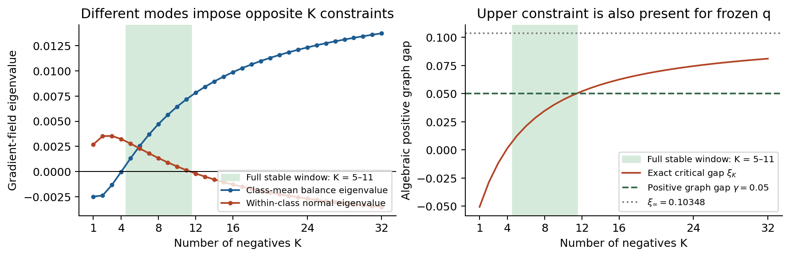

# Negative 수와 학습 피드백: 비판적 재검증 최종보고

2026-10-22. 원문 조사, 직접 증명, 직접 실행, 학술적 수준 판단을 구분한다. 주된 비교 대상은 작업 전에 고정한 **JMLR**다. 아래 ‘50%’는 분량이나 채택 확률이 아니라, 대표 기여와 필수 근거가 이미 존재하는지에 대한 연구 판정이다.

## 1. 최종 판정

**목표 도달 — 검증된 수정 방향의 국소 이론 논문으로 진행을 권고한다.**

원래의 ‘negative feedback이 의미 요인을 지우는 경계’라는 논문은 권고하지 않는다. 그 해석은 실제 endpoint 계산에서 반박됐다. 대신 이번에 확보한 중심 기여는 다음이다.

> 특정 표현 방향이 불안정할 때, negative 수를 늘리는 것으로 이를 회복할 수 있는지 정확히 판정한다. 동시에, 그 회복과 다른 관측 간 정렬을 유지하는 조건이 서로 충돌할 수 있음을 분류한다.

이 수정은 원래 가설을 단순히 약화해 참인 문장만 남긴 것이 아니다. 네 상태의 특정 점 계산을 넘어서, 여러 점수 수준과 연속 모집단에서 **어떤 유한 negative 수도 효과가 없는 경우와, 충분한 수가 있으면 회복되는 경우를 필요충분조건으로 나눈 결과**를 새로 증명했다. 다른 방향의 안정성 조건과 결합한 완결된 실현도 확보했다.

진행 권고는 이 이론 기여에 한정한다. 일반적인 비지도 학습이 이 평형점에 도달한다거나 자연 이미지 성능을 개선한다는 결과는 없다. 그런 응용을 대표 기여로 삼는다면 현재는 미도달이며, 별도의 핵심 연구가 필요하다. GPU나 외부 실행을 기다리면서 이번 판정을 유보하는 상태는 아니다.

## 2. 현재 논문의 중심 주장과 중요성

### 먼저 구분해야 하는 세 문제

표현이 흔들릴 때 그 원인은 같지 않을 수 있다.

1. **Negative가 부족한 경우:** 더 많이 뽑으면 해당 방향이 안정화된다.
2. **정책과 표현의 피드백이 문제인 경우:** 현재 표현을 보고 negative를 고르는 규칙 자체가 불안정을 유지한다. 수를 늘리는 것만으로는 고칠 수 없는 조건이 있다.
3. **다른 방향과 충돌하는 경우:** 어떤 요인들의 균형은 회복되지만, 같은 클래스의 서로 다른 관측을 함께 묶는 방향은 불안정해진다.

기존의 ‘negative가 많으면 좋다/나쁘다’는 설명만으로는 이 셋을 구분할 수 없다. 이번 논문이 제공하는 것은 새로운 loss 조합이 아니라, 명시한 모형에서 이 구분을 할 수 있는 **정확한 판정 법칙**이다.

### 주장 A: 회복 가능한 방향과 불가능한 방향을 구분한다

현재 점수를 s, 어떤 요인의 비중을 조금 바꿨을 때 점수의 변화량을 h라고 하자. Negative 정책은 기본 분포에서 뽑는 부분 epsilon과 `exp(−t*s)`에 비례해 뽑는 부분을 섞는다. 이는 **쉬운 negative를 선호하는 정책**이며, 임의의 hard-negative 방법에 대한 정리가 아니다.

조건부 균형 `E[h|s]=0`을 가정한다. 두 요인을 서로 바꾸면 s는 같고 h의 부호만 바뀌는 경우가 대표적이다. 이 조건과 국소적으로 affine한 점수 변화 아래에서 정확한 임계값을 도출했다.

\[
\epsilon_c=
\frac{(t-1)\mathbb E[h^2e^{(1-t)s}]}
{(t-1)\mathbb E[h^2e^{(1-t)s}]+Z\mathbb E[h^2e^s]},
\qquad Z=\mathbb E e^{-ts}.
\]

**epsilon이 이 값보다 크면 충분히 많은 유한 K가 해당 방향을 안정화한다. 같거나 작으면 모든 유한 K가 불안정하다.** 또한 K를 늘리다가 한 번 안정화된 이 방향이 다시 불안정해지는 일은 없다.

중요한 부분은 K가 무한히 클 때의 식 자체가 아니다. 일반적으로 극한이 나쁘다는 것만으로 중간 K에서도 모두 나쁘다고 결론 내릴 수 없다. 이번 증명은 그 결론이 가능한 조건과 정확한 경계까지 확보했다. 예를 들어 K64까지 회복이 안 보여도 실제로는 K349에서 회복하는 경우와, 정말 모든 유한 K가 실패하는 경우를 구분한다.

### 주장 B: 다른 방향은 오히려 큰 K에서 유지하기 어려워진다

하나의 클래스 안에 여러 관측이 있고 positive 관계가 그래프를 이룬다고 하자. 그래프가 얼마나 강하게 관측들을 묶는지를 algebraic spectral gap gamma로 나타낸다. 그 의미는 관측들 사이의 차이가 positive 관계를 따라 얼마나 강하게 벌점을 받는가이다.

정상적인 score-regular class geometry의 특정 normal-view 방향에서, 안정성을 위해 필요한 gap은 `gamma > xi_K`다. **xi_K가 K와 함께 엄격히 증가함을 증명했다.** 따라서 이 방향은 더 많은 negative를 사용할수록 더 강한 positive 연결을 요구한다.

이 상한 효과는 frozen 정책에도 있다. 이를 모두 ‘피드백 때문’이라고 부르면 잘못된 설명이다. A는 요인 균형 방향의 정책 반응, B는 관측 정렬 방향의 attraction/repulsion 경쟁이다.

### 주장 C: 두 조건을 합치면 정확한 유한 안정 구간이 생긴다

네 의미 상태와 여러 관측을 갖는 모형에서 **모든 접공간 방향**을 계산했다. 자연 정책 `omega(s)=4^(−s)`, epsilon=.3, positive gap=.05에서는

\[
\boxed{\text{전체 국소 안정성은 정확히 }5\le K\le11.}
\]

K4 이하에서는 균형 방향이 문제이고, K12 이상에서는 관측 정렬 방향이 문제다. 한 방향에서는 안정→불안정 재진입이 불가능하다는 주장 A와 모순되지 않는다. 서로 다른 방향이 경계를 결정하기 때문이다.

이 구조가 중요한 이유는 한 방향의 회복을 ‘표현 전체가 회복됐다’고 해석하거나, 불안정성을 모두 negative 수 부족으로 설명하는 것을 막기 때문이다. 이론적 기여의 가치는 이 정확한 분류에 있으며, 일반적인 의미 정보 소실을 주장하는 데 있지 않다.

## 3. 실제로 확보한 결과와 근거

| 결과 | 확보 수준 | 확인할 자료 |
|---|---|---|
| 여러 점수 수준에서의 정확한 curvature, 한 번만 가능한 안정화, 모든 유한 K의 rescue 조건 | **완전 증명** | [주정리](foundations/multilevel_theorem.md) |
| 연속 모집단과 product-of-spheres 실현 | **완전 증명**, 독립 수치 검산 | [연속 모형](foundations/continuous_population.md) |
| 일반 stationary score-regular geometry의 normal-view gap 단조성 | **완전 증명** | [일반 graph 정리](foundations/general_normal_graph.md) |
| 네 상태·다중 관측의 전체 spectrum과 정확한 K5..11 구간 | **완전 증명＋독립 구간 인증** | [전체 spectrum](neural/view_theorem.md), [독립 인증](review/window_certificate_check.json) |
| 실제 joint-K shared MLP의 국소 동작 | **직접 실행** | [결과](neural/results.md), [원시 요약](neural/results/window_parameter_summary.json) |
| 자기 positive가 전혀 없는20-view cycle에서도 같은 구간 | **기존 정리의 따름정리＋유리수 인증＋N80 방향미분 실행** | [인증](journal/zero_self_cycle_certificate.json), [실행](neural/results/cycle_no_self.json) |
| pair law와 unique-set law가 같은 correlated sampling의 반대 부호 | **구성적 반례＋정확한 balance 부호 인증** | [반례 설명](correlation/README.md), [유리수 인증](correlation/results/rational_certificate.json) |
| 원래 K4/5 경계의 정보 소실 해석 | **반박** | [endpoint 결과](endpoints/README.md) |

연속 product 모형은 독립 후보들의 정확한 점수가 거의 확실히 달라도 정리가 성립함을 보인다. 따라서 이산적인 score tie만의 현상은 아니다. 하지만 요인 교환 구조는 여전히 필요하다.

Joint-K MLP 검증은 모든 층을 학습하는16→64→8 encoder에서 수행했다. K4에서는 adaptive balance perturbation이 커지고 frozen은 줄어든다. K8에서는 검사한 모드가 줄어들고, K16에서는 normal-view perturbation이 두 정책 모두에서 커진다. 동일 목적의21개 parameter-flow 실행이 기준을 통과했다. 별도 표준 DOP853 해는 성장 예측 exp(3)과 상대오차7.6e-7 이내로 일치했다. **구성된 평형점의 국소 메커니즘 검증**이며 일반 학습의 성공률 실험은 아니다.

자기 positive artifact도 직접 공격했다. 각 클래스의20개 관측을 순환 그래프로 연결해 자기 자신을 positive로 뽑는 확률을0으로 만들었다. Gap `1−sqrt(10+2sqrt5)/4`가 인증된 xi11과 xi12 사이에 있으므로 같은 구간이 성립한다.80개 관측에서 직접 계산한 normal 방향미분도 일치했다.560차원 전체 수치 Jacobian이나80개 관측의 shared-network 학습을 수행했다고 주장하지 않는다.

## 4. 가장 가까운 선행연구와의 차이

원문 확인 위치·가정·목적함수·정리·실험 범위는 [원문 비교](journal/source_audit.md), [가까운 graph 연구 비교](journal/graph_extension_audit.md), [2026 추가 대조](journal/final_reassessment.md)에 있다. 중요도 판단 전에 고정한 실제 학술지 비교 대상은 다음과 같다.

| 실제 게재 논문 | 기여의 형태에서 비교한 점 | 이번에 확보해야 했던 차이 |
|---|---|---|
| *The Power of Contrast for Feature Learning*, JMLR2023 | 제한된 linear model에서도 경쟁 설명의 실패·성공을 같은 기준에서 구분 | 국소 부호 계산을 넘어 어떤 count 선택이 가능한지를 분류해야 함 |
| *On the Effect of Initialization: The Scaling Path of 2-Layer Neural Networks*, JMLR2024 | 작은 실험이어도 여러 regime를 연결하는 구조 정리가 중심 | 예제의 반복 대신 넓은 분포 법칙과 상반된 제약의 관계가 필요 |
| *Understanding Whitening Loss in Self-Supervised Learning*, TPAMI2024 | 기존 동작 해석을 수정하고 실제 설계 조건과 연결 | 순수 이론과 visual-method 기여는 구분; 현재 TPAMI용 결과는 미확보 |
| *An Augmentation Overlap Theory of Contrastive Learning*, JMLR2025 | 연결성·정렬 조건과 downstream 보장 | 현재는 가정한 aligned reference가 국소 동역학에서 유지 가능한 count를 묻음 |
| *Consistency of Augmentation Graph and Network Approximability in Contrastive Learning*, JMLR2026 | Graph consistency와 network realizability의 공백 해결 | 표현 가능한 것과 학습에서 안정한 것은 다른 질문 |

Augmentation overlap 논문의 게재 사실은 공식 기록으로 확인했지만, 큰 게재 PDF는 도구 한도로 직접 읽지 못해 본문은 저자의 arXiv판으로 확인했다. 두 판본을 byte 단위로 동일하다고 검증하지 않았다. 나머지 비교 대상의 명시된 게재/저자-hosted 본문을 읽었다. 모든 부등식을 재증명했다는 뜻은 아니다.

**신규성에서 제외한 것:** performative distribution response의 product rule, negative 관계가 feature 선택을 바꾼다는 일반론, graph Laplacian 분석, neural Jacobian pullback, 큰 K의 유효 온도 계산. 특히 single-crossing이 MLR tilt 아래 보존된다는 원리는 Athey의 기존 결과다. 이를 새 수학으로 주장하지 않는다.

그 원리들을 아는 독자에게 추가되는 것은, 현재 contrastive update가 필요한 조건을 실제로 만족한다는 증명과 그로부터 나오는 **모든 유한 count의 필요충분 분류**, 별도 normal block의 반대 ordering, 두 조건의 완결된 full-spectrum 실현이다. 기존 원문의 제목이나 식이 다르다는 것을 신규성의 근거로 삼지 않았다.

## 5. 강한 반론과 처리 결과

| 반론 | 실제 처리 | 결론 |
|---|---|---|
| K4 불안정성을 정보 소실로 오해한 것 아닌가? | 비선형 branch, noisy Bayes oracle,24개 흐름과 독립 계산 | **반론 인정. 원래 해석 기각.** 실제 약한 에너지 .46914, 표현은 injective |
| 알려진 MLR 원리의 표기 변경 아닌가? | Athey Cor5.3 본문과 증명을 직접 대조 | Aggregation은 기존. 적용 조건의 도출과 all-finite-count 분류가 남는 기여 |
| 네 상태나 이산 score tie가 현상을 만든 것 아닌가? | 다중 점수 법칙과 연속 product-sphere 정리 | 이 반론 해결. Exchange balance라는 구조적 가정은 유지 |
| 자기 positive가 많아서 생긴 것 아닌가? | Diagonal0인20-cycle 따름정리·인증·방향미분 | 이 반론 해결 |
| 모든 불안정성을 policy feedback이라고 부른 것 아닌가? | Matched frozen 비교와 normal block 미분 | Upper-K 실패는 static 기전. 원인 분리 완료 |
| 기존 neural 실험은 다른 loss 아닌가? | 실제 joint-K oracle와 shared encoder를 새로 구현 | 기존 one-negative/joint-K 불일치 해결 |
| 수치 적분 방식이 불안정을 만든 것 아닌가? | Step refinement, 표준 nonlinear DOP853, 독립 재실행 | 선언한 국소 모드에서 해결 |
| 일반 학습에서도 적용되는가? | 원래 ordinary arm과 새 weak-positive18회 실행 | **미해결. 두 arm 모두 적용성0/3. 실전 대표 주장에 사용하지 않음** |
| iid를 ESS만 맞춰 완화할 수 있나? | Pair law·unique-set law가 같은 두 sampling scheme의 반대 부호 | 불가 반례 확보. Generic dependence 중요성 자체는 기존 지식 |
| 동일 score histogram이면 stationary인가? | Non-equatorial latitude triangle 반례 | 불가. Stationarity를 별도 가정으로 분리 |

## 6. 최상위 수준과 핵심50% 재심

기준은 결과에 맞춰 낮추지 않았다. 초기 round2는 중요성 미충족으로 출발했고, 개선 후에도 검토자는 한동안 중요성·범위를 부분 충족으로 판단했다. 통합 원고 재심에서는 일반 분포의 sharp classification과 반대 제약의 구조가 이미 확보됐다는 점을 근거로, 수정된 이론 기여에 대한 판정을 바꿨다. 처음의 반대 판정은 [그대로 보존](review/pre_manuscript_verdict.md)했다.

독립 심사자의 동의 자체를 증거로 쓰지 않는다. 다음은 root의 최종 비보상형 판정이며 각 근거는 정리·원문·실행으로 연결된다.

| 항목 | 판정 | 근거와 남는 제한 |
|---|---|---|
| 신규성 | **통과** | 기존 원리를 제외해도 finite/continuous law의 all-K rescue 분류와 상충하는 spectral 조건이 남음. 알려진 graph/MLR 수학 자체는 기여에서 제외 |
| 중요성 | **통과 — 구조적 이론으로 한정** | 극한의 부호를 모든 유한 count의 가능/불가능 판정으로 바꾸고, 한 모드의 회복과 전체 유지 가능성을 분리. 실전 성능 중요성은 별도 미확보 |
| 중심 결과 | **통과** | 대표 명제·증명·완결된 full-spectrum witness·인증이 현재 존재. 미래 실험의 성공으로 빈칸을 채우지 않음 |
| 설득력 | **통과 — 선언 범위 안에서** | Frozen/adaptive, 동일 joint-K, 전체 mode, 직접 parameter flow와 독립 인증으로 식별한 치명적 원인 혼동을 검사 |
| 범위 | **통과 — 조건부 법칙으로 한정** | 연속 실현과 square 밖 normal block 확장, iid·exchange·stationary 가정 및 반례 명시. Generic asymmetry나 full stability outside square는 주장하지 않음 |
| 연결성 | **통과** | ‘어떤 K가 어느 방향을 회복할 수 있는가’라는 한 질문에 정리·graph 조건·window 실현이 연결. 상충하는 현상을 같은 원인으로 묶지 않음 |

이 평가는 작은 모형이 참이어서 자동으로 top journal에 적합하다는 뜻이 아니다. 중요성 통과의 근거는 **모형의 숫자보다 일반 분류가 중심이 됐다는 실제 변화**다. Natural-image 실험이나 일반 학습 방문을 순수 이론 경로의 사후 필수 조건으로 추가하지도 않았다. 반대로 그 결과가 확보됐다고 쓰지도 않는다.

학습 구현 담당은 자기 자료만으로 일반 학습의 중요성 공백이 닫히지 않았다는 보수적 의견을 유지했다. 이 지적은 실전 해석에 정확하며 최종 범위에 반영했다. [엄격 재심](review/final_review.md)과 [고정 학술지 기준의 재심](journal/final_reassessment.md)은 이론 기여의 구조적 중요성을 근거로 통과를 판단했다. 찬성자 수를 평균내어 최종 판정을 만든 것이 아니다.

## 7. 남은 작업

### 현재 수정 논문을 완성하는 작업

- 주정리·normal 정리·full witness의 가정과 정리 의존성을 제출 원고로 일관되게 편집한다. [현재 원고](manuscript.md)에 실질 내용과 증명을 이미 연결했다.
- 단순 square의 과거 결과와 이번 일반화의 기여를 분명히 분리하고, 기존 MLR/graph 도구의 인용을 정리한다.
- Continuous floor 그림과 count/floor/gap 도식 등 설명을 보강한다. 같은 oracle seed를 더 늘리는 것으로 중요성을 보상하지 않는다.
- 재현 패키지의 최종 공개 snapshot을 유지한다. 별도 임시 복사본에서 핵심14개 script를 다시 실행했고 모두 통과했다. 인증·oracle 등 저장된 핵심 수치5개 묶음도 일치했다([실행 기록](audit_snapshot.json)). 수학적 의미가 바뀌는 실패가 나중에 발견되면 판정을 다시 열어야 한다.

이들은 이미 증명된 대표 기여를 완성하는 일이다. 아직 없는 핵심 실험이 성공해야만 현재 명제가 생기는 상태는 아니다.

### 별도의 새 핵심 연구가 필요한 확장

일반 비대칭 geometry의 전체 spectrum, heterogeneous anchors, 임의의 sampler와 nonlinear score path, 학습이 어떤 평형점을 방문하는지, 전역 basin과 실제 task harm는 현재 결과의 자동 보강이 아니다. 이들을 주장하려면 새로운 이론·실험이 필요하다. 특히 ordinary training의 실전 규칙이나 TPAMI용 기여를 원한다면 이 문제가 다시 중심 과제가 된다.

현재 이론 논문부터 진행할 경우 첫 작업은 GPU 벤치마크 구축이 아니라 **주정리의 범위와 positive-gap 정리를 하나의 제출용 서술로 통합하고, 가장 가까운 원문의 가정/결론 대조표를 정제하는 것**이다. 별도의 실제 적용 논문에 투자할지는 그 다음 결정으로 분리하는 편이 타당하다.

## 산출물

[논문 원고](manuscript.md) · [재현 안내](reproduction.md) · [연구 기록](progress.md) · [주정리와 코드](foundations/README.md) · [실제 학습과 원시 결과](neural/README.md) · [독립 검토](review/final_review.md) · [학술지 비교](journal/README.md) · [검증한 참고문헌](references.md).
