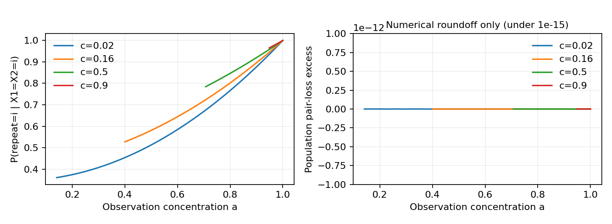

# 실제 실행 결과

2026-10-22. [프로토콜](protocol.md)을 먼저 기록한 뒤 실행했다. Population oracle, finite-pair MLE, numeric inverse, Root의 two-point test를 구별한다. Neural MCInfoNCE 또는 실제 이미지 uncertainty 실험은 수행하지 않았다.

원자료의 존재적 가설은 아래 categorical 결과로 지지된다. Circle의 식별 성공은 이번에 추가한 강한 H1만 반박하며 원래 가설을 반박하지 않는다. 두 branch의 결과를 서로 대체하지 않는다. 최종 기각은 현재 결과의 신규성과 기여 폭에 대한 판단이다.

## 재현

Repository root에서 아래 두 명령을 실행한다.

    OPENBLAS_NUM_THREADS=1 python pair-uncertainty/code/run_study.py
    OPENBLAS_NUM_THREADS=1 python pair-uncertainty/code/acquisition_check.py

Python3.12, NumPy/SciPy/Matplotlib의 정확한 버전은 [environment.json](results/environment.json)에 있다. Seed/grid는 protocol에 기록했다. 원문PDF·dataset·checkpoint는 저장소에 올리지 않았다.

버전은 [requirements.txt](requirements.txt)에 고정했다. 같은 seed는 서로 다른 n조건에서 다시 사용하므로 n조건 간 실행을 모두 통계적으로 독립이라고 세지 않는다. 각 표의 평균±표준편차는 고정 n의 서로 다른10seed에 대한 값이며, primary와 confirmation seed집합은 분리했다.

## 1. 기존 toy 새 분수 산술 검산

Q는 diagonal3/5, off1/5. R은 diagonal1/15, off7/15. 둘 다 positive doubly-stochastic full rank다. Python Fraction으로 다시 계산했다.

| 양 | Q | R |
|---|---:|---:|
| pair diagonal |11/75|11/75|
| pair off-diagonal |7/75|7/75|
| triple111 |29/375|229/3375|
| P(X3=1\|X1=X2=1)|29/55|229/495|
| posterior entropy(nats)|.9502705392|.8918673953|

Triple 차이32/3375. [원래 분수](results/summary.json). 이는 이전 보고서의 재확인으로 신규 발견이 아니다.

## 2. unknown categorical channel의 sharp set

c=a²b 고정404조건을 matrix law로 계산했다. Pair-law equality 및 [이론식](theory.md)의 최대오차5.55e−16이다.

c=.16에서 same-observation-agreement context의 repeat-probability sharp interval은 [.52727,1]이다. 101point grid로 sharpness를 판단한 것이 아니라 모든 feasible parameter를 정리한 증명이 sharpness를 준다. Grid는 구현 검산이다.

## 3. finite sample이 구조 ambiguity를 제거하지 않는다

truth a=.8,b=.25(c=.16), actual repeat truth P(R=i|X1=X2=i)=.8020202. Primary0–9, confirmation101–110, n1000/10000/100000의60dataset에서 pair MLE를 계산했다. 같은 dataset의 세 대안은 같은 pair estimate를 쓴다. Known b는 privileged structural information을 가진 oracle이며 동등 정보의 방법 경쟁이 아니다.

| n=100000 조건 | Primary Brier regret 평균±표준편차 | Confirmation |
|---|---:|---:|
| known b=.25 oracle |.00003238±.00003338|.00004820±.00005586|
| unknown b, b=1 선택 |.15830±.00052|.15717±.00093|
| unknown b, a=1 선택 |.088887±0|.088887±0|

Pair excess log-loss는 primary세 조건 모두 약2.83e−6, confirmation약4.20e−6로 같다. Independent-repeat prediction은 다르다. 이는 optimizer failure가 아닌 population ridge의 구조 ambiguity다. a=1의 Brier regret가 반복마다 같은 이유는 predictor가 언제나 R=X1을 예측하기 때문이다.

**측정 정정:** a=1은 true conditional의 양의 질량 사건에0을 부여하므로 정확한 log regret는∞다. 첫 실행은1e−15 floor로7.577을 계산했다. [초기 파일](results/initial-run/README.md)을 보존하고 protocol Amendment1 뒤 동일 설정을 재실행했다. 최신 CSV는 clipped diagnostic과 exact-infinite flag를 구별한다. 이 finite숫자를 정확한 logarithmic risk로 보고하지 않는다.

[Raw](results/finite_sample.csv), [요약](results/finite_sample_summary.csv).

## 4. acquisition 정보와 개수 구분

추가 실행 전 Amendment2 작성. Primary20–29/confirmation201–210의60dataset. npositive pairs+nanchor-state independent repeats는 총3n genuine acquisitions. 비교군은 같은3n budget의1.5n positivepairs다. Repeat는 r=a²라는 새 식을 주지만 positivepair를 늘리면 c추정만 정밀해진다.

| n=100000 | Primary 평균±표준편차 | Confirmation |
|---|---:|---:|
| repeat 기반 a estimate |.800182±.001334|.799607±.001049|
| repeat 기반 b estimate |.249106±.004450|.250655±.002999|
| positive-only a-set plugin width |.600732±.002282|.599959±.002962|

Positive-only population width는 정확히.6다. Plugin width는 정직한 confidence interval을 뜻하지 않는다. Copy R=X1을 independent라고 잘못 처리하면 a=1이 나온다. Copy는 비용0인 가정위반 진단으로3n budget의 경쟁방법이 아니다. 이 제한모형에서는 새 repeat pair law가 충분하며 joint third-order tensor가 필요하다는 주장과 다르다.

[Raw](results/acquisition.csv), [요약](results/acquisition_summary.csv).

## 5. circle vMF: exact 식별과 numerical inverse 구분

Primary5parameterpairs×1/2/8harmonics×20starts=300fits. Confirmation20randompairs×8harmonics×20starts=400fits. Log harmonic residual은 oracle inverse diagnostic이며 sample likelihood나 neural loss가 아니다. 작은 coefficient를 relative error로 가중하므로 이 수치로 실제 표본비용을 판단할 수 없다.

- 1harmonic: 모든 primary조건에서 서로 다른 parameters가 residual≈machine precision로 맞는다. 전체 pair law를 잃은 measurement bottleneck이다.
- 2harmonics: truth(2,5) 외(3.37817018,1.62100033)이 두 harmonic을 numeric precision로 맞췄다. 이것을 full-law 비식별로 해석하지 않는다.
- 8harmonics: Primary100fits 중 residual<1e−8은63개. 해당subset 최대 parameter error6.77e−6. 나머지 local/boundary fits도 보존했다.
- Confirmation400fits 중214개가 residual<1e−8. 해당subset 최대 parameter error.01672. 예: truth(.4843792,.4731783), fit(.4769004,.4881355), residual3.14e−9. Near-diagonal instability/finite tolerance이고 exact counterexample가 아니다.
- Optimizer의 success flag가 true여도 큰 residual 또는 boundary에서 멈춘 경우가 있다. 다른 해를 못 찾았다는 사실은 uniqueness의 증거로 쓰지 않는다. [전체 수열 증명](theory.md)이 uniqueness의 근거다.

Raw moment Jacobian의(a,b)=(1,1) singular values는 약.157956와1e−13이다. Derivative columns의 정확한2:1비례 검산이다. (.5,8)의 작은 singular value도약1.17e−5다. Ill-conditioning과 structural nonidentification을 섞지 않는다.

[Primary](results/vmf_inverse_primary.csv), [confirmation](results/vmf_inverse_confirmation.csv), [Jacobian](results/vmf_moment_jacobian.csv).

## 6. 독립 경쟁 설명 검증

Root는 별도 [operational-uncertainty](../prevalidation-20261022/operational-uncertainty/analysis.md)에서 Fourier-density KL계산과 단순가설 LRT를 실행했다. Equal-channel point에서 KL은 diagonal대비 t⁴, 부호대조 t⁶다. 다른 담당·코드의 검증이며 위700inverse fits와 같은 실행이 아니다.

그러나 Rotnitzky2000이 higher-order singular likelihood와 magnitude/sign scales를 이미 다룬다. 이번 모형의 직접 계산을 새 일반 통계원리나 모든 nuisance에 대한 minimax theorem으로 부르지 않는다. 이 경쟁 설명은 최종 판정에 남는다.
