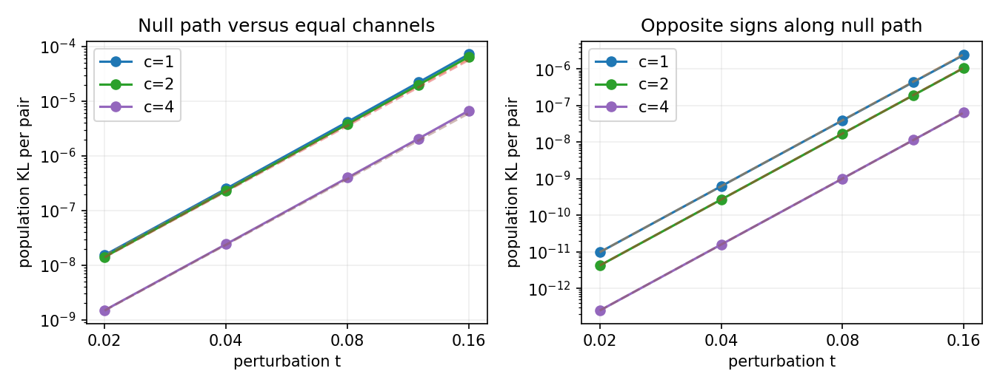

# 정확 식별성과 유한 표본 구분: 직접 증명 및 실행 결과

상태: 분석·실행 완료, 독립 검토 중. 이것을 새 일반 통계 원리라고 주장하지 않는다. [사전 설계](protocol.md), [코드](run.py), [원자료](results/summary.json).

## 모델과 원래 질문의 연결

관측은 원 위 두 각도다. latent는 균일하고, 각 관측은 자신의 latent에 concentration a의 독립 von Mises 오차를 더한다. positive latent 사이에는 concentration b의 von Mises transition이 있다. 전역 회전은 동치다. 관측 channel a와 correspondence channel b는 의미가 달라 교환을 동치로 두지 않는다. forward model과 posterior 모두 같은 von Mises family인 제한 모형이다.

두 각도의 차 D는 독립 VM(a), VM(a), VM(b)의 합(mod 2π)과 같은 분포다. r_m(v)=I_m(v)/I_0(v), f_m(v)=log r_m(v)로 두면 density는

$$p_{a,b}(d)=\frac{1}{2\pi}\left[1+2\sum_{m\ge1}r_m(a)^2r_m(b)\cos(md)\right].$$

이 Fourier identity는 convolution의 고전 성질이다. exact injection은 별도 [독립 증명](../reviews/uncertainty/exact_identification.md)에서 다룬다. **unknown b라고 해서 a가 반드시 비식별인 것은 아니다.** 본 분석은 joint identifiable한 모형에서도 필요한 관측량이 왜 커질 수 있는지를 묻는다.

## 직접 증명: equal-channel 지점의 특이성

임의 c>0를 고정하고 a=c+t,b=c−2t, |t|<c/2로 놓는다. 모든 Fourier mode에서 log coefficient의 1차 미분이 2f'_m(c)−2f'_m(c)=0이다. 따라서 두 parameter score는 비례하고 pair-law Fisher matrix는 rank가 떨어진다. 정규적인 1차 inverse-Lipschitz 보장은 이 지점에서 불가능하다.

Taylor 전개는

$$2f_m(c+t)+f_m(c-2t)=3f_m(c)+3f''_m(c)t^2-f'''_m(c)t^3+O(t^4)$$

를 준다. 따라서 uniform density expansion p_t=p_0+t²A+t³B+O(t⁴)이 성립하며

$$A(d)=\frac{1}{\pi}\sum_{m\ge1}3r_m(c)^3 f''_m(c)\cos(md),\qquad
B(d)=-\frac{1}{\pi}\sum_{m\ge1}r_m(c)^3 f'''_m(c)\cos(md).$$

모든 c>0에서 A와 B는 0이 아니다. 큰 m에 대한 Bessel series를 c의 양의 compact neighborhood에서 미분하면 f''_m(c)=−m/c²−(log I_0)''(c)+O(1/m), f'''_m(c)=2m/c³−(log I_0)'''(c)+O(1/m)이므로 충분히 큰 mode의 계수가 nonzero다. Factorial Fourier decay 때문에 각 고정 차수 미분의 합이 균일 수렴한다. 양의 smooth convolution density는 compact circle에서 양의 하한을 가져 KL Taylor expansion도 정당화된다.

이에 따라 직접 얻는 명제는

$$\mathrm{KL}(p_t\|p_0)=C_4(c)t^4+O(t^5),\quad C_4=\tfrac12\int A^2/p_0>0,$$
$$\mathrm{KL}(p_t\|p_{-t})=C_6(c)t^6+O(t^7),\quad C_6=2\int B^2/p_0>0.$$

이는 **서로 다른 단순가설 검정**이다. diagonal과 떨어졌는지, null path의 어느 부호인지의 비용을 혼동하면 안 된다. n개 독립 pair의 KL은 n배이므로 Pinsker로 n·KL이 작은 두 법칙은 oracle도 잘 구별할 수 없다. 반대로 Hellinger expansion으로 n·t⁴ 또는 n·t⁶가 커지면 각 해당 두 점 간 일관된 검정이 가능하다. 일반 MLE의 minimax rate·모든 nuisance를 허용한 학습기 보장은 여기서 증명하지 않았다.

## 직접 실행한 것

- c=1,2,4 × t=.02,.04,.08,.12,.16의 15 population 조건. 32/64/96 modes와 4096/8192/16384 grid로 적분 수렴을 확인했다. Fourier 식을 독립 discrete convolution으로 확인한 최대 sup 오차는 3.89e−16이다.
- 작은 t 세 점의 log-log slope는 diagonal 대비 4.029–4.050, 부호 대비 5.994–6.001이었다. 이것은 위 증명의 수치 검산이며 일반성의 근거를 seed 수로 대신하지 않는다.
- c=2에서 C4=.0868619740, C6=.0657348407. t=.08이면 KL(p_t||p_0)=3.8103e−6, KL(p_t||p_−t)=1.7147e−8이다. n=10000에서 후자의 equal-prior oracle 오류는 Pinsker만으로도 최소 약 .4954다. 이는 parameter를 아는 검정에도 적용되는 보수적 하한이다.
- 사전 cap 안에서 c=2,t=.12/.16 diagonal 대비 oracle likelihood-ratio 검정을 primary6+confirmation6 seeds로 실행했다. 각 조건·seed의 양 법칙에서 샘플을 따로 생성했다. 총 1,571,928 pair를 생성했다. t=.08 및 부호 대조의 요구 관측량은 cap을 넘겨 실행하지 않았고 [summary](results/summary.json)에 빠진 조건과 이유를 보존했다. 없는 large-n 실험을 완료했다고 주장하지 않는다.
- 표본 LRT는 known-parameter 두 점 검정이다. neural encoder 학습, posterior calibration, 일반 ML estimator의 회복으로 해석하지 않는다. 각 조건당 12회 정도의 작은 반복은 정확한 오류율 추정에 부족하다.

## 강한 경쟁 설명과 신규성 판단

독립 검토자가 Rotnitzky et al. (2000), *Likelihood-based inference with singular information matrix* §2/§4.3에서 magnitude n^−1/4와 sign n^−1/6 현상을 직접 확인했다. 따라서 위 차수 자체는 새 일반 원리가 아니다. 본 작업은 이 circle convolution 모형의 직접 대입과 명시적 상수·검증이다.

독립 acquisition X1′를 X1과 같은 latent에서 새로 받으면 E cos(X1−X1′)=r1(a)²다. 이 관측에서 a를 식별한 뒤 기존 pair의 첫 계수로 b를 구할 수 있다. 이 identity 역시 Delaigle–Hall–Meister (2008)의 replicate-difference Fourier 식과 같은 원리다. 원형 공간이라는 차이만으로 새 기여를 주장하지 않는다. 같은 bytes의 복제나 공유된 sensor noise를 가진 crop는 이 식의 독립성 전제를 충족하지 않는다.

남는 질문은 실제 heteroscedastic SSL 관측에서 이런 channel-role 혼동을 어떻게 검증하고 최소 관측 설계로 정량 보증할 것인가다. 이 핵심 확장이 아직 없으면 현재의 circle 계산만으로 장기 독립 연구를 권하지 않는다.
