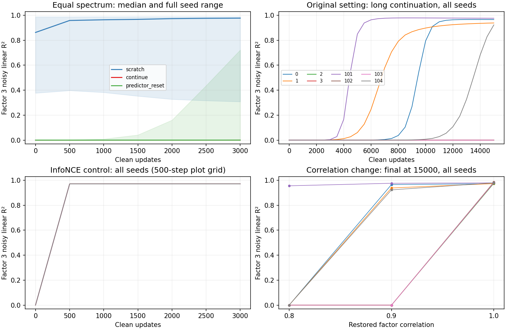

# 실제 실행 결과 — 후보 1

주지표는 normalized representation에 고정 noise sigma=.1를 더했을 때의 population 최적 **linear R²**다. noiseless 정보량, 모든 decoder의 성능, 자연 이미지 결과가 아니다. 4개 pilot + 4개 별도 확인 seed를 사용했으며 동일 DGP·구현을 공유하는 초기값 반복이다.

## 원래 equal-spectrum 설정, clean 3000 step

| 정책 | 최종 R² 최솟값 | 중앙값 | 최댓값 | 사전 90% 기준 도달 |
|---|---:|---:|---:|---:|
| scratch | 0.307952 | 0.977141 | 0.988531 | 8/8 |
| clean_long | 0.337462 | 0.977939 | 0.988227 | 8/8 |
| continue | 2.43789e-08 | 2.17974e-06 | 0.00424207 | 0/8 |
| optimizer_reset | 1.43724e-07 | 8.9844e-06 | 0.0531923 | 0/8 |
| optimizer_normmatch | 1.60266e-07 | 4.9204e-05 | 0.0184614 | 0/8 |
| teacher_sync | 2.55769e-08 | 3.76198e-06 | 0.00308631 | 0/8 |
| predictor_reset | 2.31458e-08 | 6.18764e-05 | 0.722071 | 0/8 |
| head_teacher | 2.37958e-08 | 5.61589e-05 | 0.744705 | 0/8 |

Scratch의 초기 factor 3 R² 자체가 높다. 특히 일부 seed는0step부터 threshold를 충족하므로 위 scratch값은 새 factor 획득만이 아니라 random initialization의 정보 보존을 포함한다. 그 값을 새 학습 성공으로 읽지 않는다.

Predictor reset과 head+teacher는 seed 101에서 각각 .7221/.7447의 상당한 **부분 회복**을 보였다. 모든 reset이 무효라는 결론은 틀리다. 다만 사전 90% 기준까지 도달한 reset은 없었다. Predictor parameter와 해당 Adam moments를 함께 reset한 추가 control에서 seed 101은 .0490으로 달라졌다. Head개입의 결과를 head에만 저장된 기억의 증거로 해석하지 않는다.

## 장기 continuation 및 상대 pair correlation 변경

| seed | 원래 rho3=.9:3000 | 원래 rho3=.9:15000 | rho3=.8:15000 | rho3=1:15000 |
|---|---:|---:|---:|---:|
| 0 | 1.85201e-05 | 0.965753 | 5.02845e-07 | 0.972457 |
| 1 | 0.00215613 | 0.938428 | 2.40209e-06 | 0.97362 |
| 2 | 3.58741e-06 | 3.01354e-05 | 1.75982e-05 | 0.97591 |
| 3 | 2.72637e-07 | 1.09257e-05 | 5.33572e-11 | 0.981537 |
| 101 | 0.00424207 | 0.976031 | 0.955865 | 0.97925 |
| 102 | 2.43789e-08 | 4.76694e-06 | 1.69008e-06 | 0.984999 |
| 103 | 2.76908e-08 | 4.18692e-05 | 3.37075e-08 | 0.980347 |
| 104 | 7.72074e-07 | 0.923124 | 1.3683e-08 | 0.979747 |

원래 setting에서도15000 step까지8개 seed 중 4개가 .9이상으로 회복했다. 3000 step 실패를 영구 고착으로 읽을 수 없다. rho3=1은8개 모두 .972–.985로 회복했으나 다른factor 손실이 동반될 수 있다(예:seed3의factor 2 R²≈4.87e−6). rho3=.8의seed 101도 .9559로 회복했다. 따라서 작은 fixed-head spectral sign은 실제 MLP의 필요충분조건이 아니다.

## 목적함수 대조: population InfoNCE, temperature1

| seed | deficit후 R² | clean90%도달 step | clean3000 R² | clean15000 R² |
|---|---:|---:|---:|---:|
| 0 | 3.19e-24 | 150 | 0.97087379 | 0.97087216 |
| 1 | 6.96e-25 | 250 | 0.97087379 | 0.97090881 |
| 2 | 2.64e-25 | 100 | 0.97087379 | 0.97085781 |
| 3 | 2.09e-25 | 150 | 0.97087379 | 0.97093121 |
| 101 | 1.72e-24 | 100 | 0.97087379 | 0.97088432 |
| 102 | 7.51e-25 | 150 | 0.97087379 | 0.97090324 |
| 103 | 8.33e-25 | 50 | 0.97087379 | 0.97087369 |
| 104 | 1.81e-14 | 250 | 0.97087379 | 0.97087378 |

같은 raw marginal·pair복구·encoder·Adam/LR 아래 contrastive 대조에서는 50–250 step에90%기준에 도달했다. Agreement와 이 비교에서 teacher/head/목적함수가 함께 달라지므로 **teacher만의 인과효과**가 아니다. [직접 증명C](theory.md)는 제한 diagonal family에서 agreement의 flat optimum과 contrastive의 strict full-factor optimum을 구분한다.

## 검산과 증거 강도

- Owner cosine gradient 중앙차분 최대8.89e−11, InfoNCE4.04e−11. Pair marginal/correlation 최대3.34e−16.
- 독립 reviewer는 새 구현으로 cosine5.28e−10, contrastive4.81e−11, flat family 및 dormant-mode Jacobian을 검산했다. [독립 기록](../prevalidation-20261022/reviews/recovery/review.md).
- [이론A–C](theory.md)는 직접 증명, neural표는 직접 실행이다. 전자의 제한 모형이 후자의 모든 경로를 정량 설명했다는 주장은 없다.
- EMA teacher sync는 초기lag만 없앤다. Adam normmatch는 block scalar norm만 맞춘다. 어느개입도 고유한 기억위치나 SSL특유원인을 증명하지 않는다.
- Figure의 각 선은 정해진 모든seed를 포함한다. 원자료의 고정간격CSV, 모든 run summary, full trace SHA/재생성경로를 보존했다.

## 저장·재현

Fulltrace는 outcome별 선택 없이500 step간격+final로 CSV를 줄였다. 모든 run의최종값과 50 step threshold는summary에 남아 있다. Full raw JSON경로·행수·바이트수·SHA256은 각 `*_trace_manifest.json`에 있다. Scratch raw는 재현 가능한 임시자료이며 저장소의코드+seed가 보존 근거다. 이 실행의full trace 디렉터리는 `/workspace/scratch/7655b5d2f6fb/research/ssl-recovery-raw`다.

실행명령은 [reproduction.md](reproduction.md). 큰 dataset/checkpoint/원문PDF는 저장소에 넣지 않았다.
