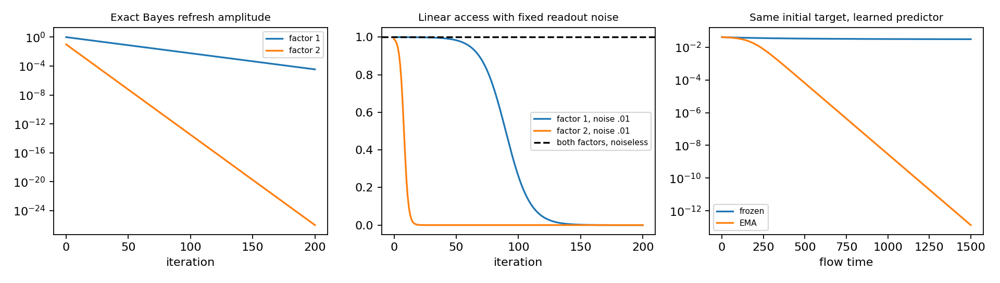

# 실행 결과와 해석

**확보한 결과는 population 모형의 exact 계산 및 ODE 수치해다. 이미지 신경망 학습이나 새로운 벤치마크 실험은 수행하지 않았다.** 원문/theory와 대응하는 가설이 기존 결과임을 확인했으므로 무의미하게 실험 규모를 키우지 않았다.

## 재현

저장소 루트에서:

```bash
OPENBLAS_NUM_THREADS=1 OMP_NUM_THREADS=1 python target-correction/code/run_study.py
OPENBLAS_NUM_THREADS=1 python target-correction/code/context_basis_control.py
python target-correction/code/frozen_exact_check.py
```

환경은 [environment.json](environment.json), 실행 전 기준은 [../protocol.md](../protocol.md), 수학은 [../theory.md](../theory.md). 확인 seeds20261022/23/24는 초기 공통 amplitude의 ±5% jitter만 무작위화한다. 데이터 noise나 neural optimizer 여러 회 반복이 아니며 따라서 이 108개를 독립적인 이미지 학습 재현으로 세지 않는다. matrix basis control은 별도 seeds20261025/26을 사용한다.

| 검증 | 직접 실행 규모 | 수치 결과 | 의미 |
|---|---:|---|---|
| 4-state Markov Bayes teacher recurrence | rho=(.9,.5), beta3개, 201 steps | exact formula max error8.88e−16 | 수축은 확인되지만 모든 finite step에 invertible; MI 소실 증거 아님 |
| learned predictor/EMA ODE primary | 72개 (rho·eta·beta·initial) | equilibrium 최대오차5.18e−9 | theory Proposition3의 collapse/recovery boundary와 일치 |
| 별도 조건/seed 확인 | 108개, primary 밖 rho/beta, 3 seeds | equilibrium 최대오차8.64e−10 | narrow scalar family의 예측 재확인 |
| Jacobian formula | 36개 equilibria | eigenvalue 최대오차3.11e−15 | beta가 fixed-point 안정성 부호를 바꾸지 않음 |
| fixed predictor 안정성 | 54개 | analytic sign criterion 54/54 일치 | predictor gain/weight decay 설명 분리 |
| full-rank target basis | 20개, 최소 singular .001 | invertible recovery 최대오차4.71e−14 | population conditional prediction에서는 basis·scale 변화가 정보 교정이 아님 |
| frozen finite-time exact solution | 기존 trajectory1001개 | logistic solution 최대오차1.78e−11 | 느린 수렴을 equilibrium 측정으로 오해하지 않음 |

### 같은 입력·초기 target에서도 frozen과 EMA는 다르게 끝날 수 있다

사전 algebra에서 지정한 rho=.5, eta=.02, s0=.04192235936, beta=1. frozen teacher의 student amplitude는 t1500에서 **.03140340265**, exact asymptotic equilibrium은 **.03100289793**다. 같은 시간의 EMA student amplitude는 **1.3279e−13**이다. 초기 입력과 target에는 분명히 factor 정보가 있다.

그러나 이것은 새 자기교정 경계가 아니다. Tian2021의 predictor/weight-decay basin에서 `eta/rho<s0<s−`인 구간을 골라 정확히 설명한 결과다. eta=0 control에서 이 stable collapse basin은 사라진다.

### 작은 초기 신호는 느리게 회복할 수도 있다

rho=.8, eta=0, beta=1에서 s=.2에 처음 도달하는 시간:

| 초기 s0 | 도달 시간 | rho*s0*time |
|---:|---:|---:|
| .001 | 1257.8238 | 1.0063 |
| .003 | 421.6704 | 1.0120 |
| .01 | 126.9015 | 1.0152 |

이 family에서 작은 positive 신호가 일정 시간 보이지 않는다는 것은 attractor에 갇혔다는 증거가 아니다. 1/s0 escape time이 결정적 대안 설명이다.

### Factor 접근성은 readout 조건에 달려 있다

Bayes refresh의 약한 factor2에서 beta=.5, t20의 amplitude=.0003171212이다. 무잡음 관측 factor linear R²는 여전히1; 같은 feature에 고정 noise SD=.01을 더하면 R²=.00100465. t100에는 R²가 약1.03e−23이지만 무잡음에서는 여전히1이다. plot의 성능 저하는 **미리 명시한 fixed readout noise**에서 생긴다. 이를 무제한 decoder의 information loss로 바꾸어 말하지 않는다.



### 판정

직접 얻은 수치 결과는 모두 exact theory 또는 기존 Tian2021 flow의 직접 대입과 일치했다. 새로운 학습 원리나 계층적 자기교정 결과를 뒷받침하지 않는다. 이 결과는 긍정적 논문 초안으로 포장하지 않고 기각 보고의 근거로 보존한다.
